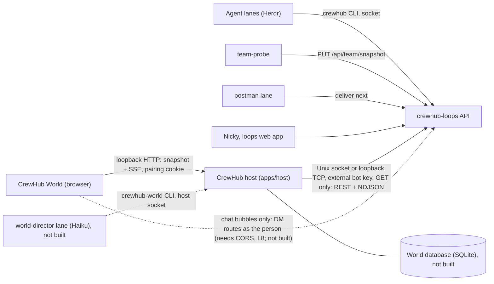

# Architecture

## Decision

CrewHub World is a browser world served by a small CrewHub host that reads
crewhub-loops. There is no bridge and no Tauri. The decision is
[ADR 0005](decisions/0005-crewhub-world-on-loops.md) and the full plan is
[LOOPS_INTEGRATION_PLAN.md](LOOPS_INTEGRATION_PLAN.md).

Towns and rooms are CrewHub's own; every fact is crewhub-loops'. See
[the town plan](TOWN_PLAN.md) for the layout model, with the runtime-binding parts
superseded. The [design system](DESIGN_SYSTEM.md) supplies the UI tokens and
components.

**The diagram below is the target.** Three of its arrows run today: the agents, probes
and people writing to crewhub-loops (loops' own), the host reading crewhub-loops, and
the browser reading the host. Not built: the world database, the chat bubbles' route to
loops (blocked on CORS, L8) and the director lane.



## What is built

The world runs in two modes on one model. **Demo mode** (the default) runs only in the
browser on a scripted source: no network call, no account, no model call. **Live mode**
runs the same browser app against `apps/host`, which reads a real crewhub-loops; the
source is decided once at start (`auto`: live when a host answers `/world-api/health`
within 1.5 s, else demo; `?source=live|demo` overrides).

| Package | Role |
| --- | --- |
| `packages/loops-client` | crewhub-loops types, hand-written runtime validators, the event allowlist (`ticket.quiet` and `automation.ran` with typed payloads since round 7; `owner-request.updated` known and skipped), the `WorldSource` seam, and the live source `createHostSource` (snapshot, then SSE events by `seq`; `ConnectionState` for the chip; `probeHost`, `connectHost`, `forgetHostKey`) |
| `packages/demo` | `DemoSource`: a deterministic, in-memory crewhub-loops with a 16-minute storyline, four scenarios, its own lanes, the world's key as its observer and a CI bot (as loops answers external bots), the quiet and automation events in the storyline, playback controls and the chat API the bubbles call |
| `packages/loops-fake` | The same storyline served over HTTP the way crewhub-loops `4cdcd383` serves it (bearer keys, `from=tail`, sealed cursors, per-key visibility, 429, archived projects): the host's end-to-end test and the live browser checks run against it ([LOOPS_REAL_VS_FAKE.md](LOOPS_REAL_VS_FAKE.md)) |
| `packages/world-model` | Projection, `reduceWorld`, `describeWorld` (text view), town document, catalogue, director intents, `where`, the agent card's facts, the quiet facts and the board cards (`board.ts`); it never knows which source feeds it |
| `packages/world-engine` | Grid, footprints, placement, pathfinding, the prop format (`crewhub-prop/1`) and its validator |
| `packages/world-style`, `packages/style-greenhouse`, `packages/world-cast`, `packages/cast-*` | The style and cast seams and their data ("World styles" below) |
| `apps/world` | The browser app: Three.js town and building scenes, the minimal UI, the chat bubbles mirrored from crewhub-loops, the `useWorld` seam, the Connect screens and the Connection panel, the dust on a quiet package (`dust.ts`, the object layer) |
| `apps/host` | The relay to crewhub-loops ("The host" below) |

Data flow, the same in both modes:

```text
DemoSource | HostSource -> Projection -> reduceWorld -> renderer / describeWorld
```

Both sources emit loops-shaped envelopes with increasing `seq`. The projection
applies them idempotently. `reduceWorld` maps facts to buildings, rooms, work
objects, agent placements, visits and closed buildings. The renderer and the text
description read only that model.

Phase status (plan section 10; the dates and details are in [the roadmap](ROADMAP.md)):

- Phase 1 (town, loops-client, demo source): built in demo mode; live since 2026-10-07, against the real crewhub-loops since 2026-10-21
- Phase 2 (chat mirror, backed by the demo chat API): built in demo mode; live needs CORS in loops (L8), not built
- Phase 3 (interiors, three rooms, the ticket drone, a person carrying work into Done, closed buildings): built in demo mode and live; the world database is not built
- Phase 4 (town paths and dynamic pathfinding): built in demo mode and live
- Phase 5 (town document and build mode): built in demo mode; live mode keeps its own town document in the browser
- Phase 6 (scripted director and `where`): built in demo mode; `where` works live; the scripted director also runs in live mode as its own opt-in, off by default and labelled "scripted" on every line (round 11); the real director is not built

## The host (`apps/host`)

One Node process, no dependency beyond Node, loopback only. Its parts, each a file in
`apps/host/src` with its tests in `apps/host/test` against a loops stub on port 0:

- **Discovery** (`discovery.ts`): the env's URL or socket is taken as given; else the Mac
  app's data folder is read (never written): its Unix socket `run/api.sock`, then the
  port in `settings.json`, each probed with the public `GET /api/health`, the two in
  parallel; nothing found: again every 5 s. Loops going away later makes it look again.
- **The key** (`config.ts`, `keyStore.ts`, `keyCheck.ts`): read from `CREWHUB_WORLD_KEY_FILE`,
  else the stored key `<config dir>/loops-key`, else the old default file; none: the host
  starts keyless. Every key is checked with `GET /api/auth/me` and one board read; a probe
  key, a Read-only bot, the builder key and an unknown key are rejected with the reason in
  the loops web's words. A verdict on the key needs a definite 401 or 403 from a loops
  whose health answers; a timeout, a refused connection or a 5xx is `down` and the key
  stays `unchecked` or `ok`. A rejected stored key is kept with its reason until a person
  pastes another or forgets it; while it waits the host leaves loops alone (no stream retries)
  and asks about the kept key every 5 min, a keyless health probe first and at most one probe
  a minute (`RECHECK_MS`; health's `key.recheckAt` says when), so a bot re-enabled in loops
  comes back by itself (round 8). The stored key is written whole, 0700/0600, never logged
  or echoed (tests grep every response and log line).
- **The connect routes** (`host.ts`): `POST /world-api/connect {key}` from a paired browser
  on an allowed origin checks the key, stores it and switches the host to it without a
  restart (the old upstream stream stopped first, every tab reset); `DELETE` forgets it.
  These are the host's only writes, to its own folder.
- **Pairing** (`pairing.ts`): a one-time link (`/pair/<token>`, 10 minutes) exchanged for an
  `HttpOnly; SameSite=Strict` cookie signed with a secret; `npm run world` keeps that secret
  in `<config dir>/pairing-secret` (0600), so a restart keeps every paired browser; the
  plain `npm run host` uses a per-run secret. Every data route answers 401 `not_paired`
  without the cookie; health stays open and shows only states until paired.
- **The snapshot** (`snapshot.ts`): assembled as `read-model.md` says (the stream's position
  first, then projects, boards, principals, agents, team, watchdog, milestones and
  releases, the archived projects from the event log), paged lists followed to the end,
  the reads in parallel under a cap of 6 in the projects' order, timed and counted; the
  host's own principal is named as the `observer` so the world does not draw it. Since round
  9 the snapshot also carries what only the log holds (`readLogFacts`, the picking shared with
  the demo in `loops-client/src/logFacts.ts`): the open quiet stretches and the latest
  automation runs, read from `GET /api/events?types=ticket.quiet,automation.ran` in a window
  of 20 000 seqs before the cursor (at most 20 pages of 500), bounded to the open tickets in
  planned, in progress and review, then the ticket and comment events from the oldest
  candidate on, a stretch dropped when a person or an agent touched the ticket since (a
  `system` row never ends one, as loops' own `people_activity` rule says); the facts travel as
  the envelopes they are (`quiet`, `automationRuns`), the step line says "from the log 2
  quiet, 3 runs", and past the page cap no quiet is handed over, the runs read so far are. The
  archived slugs it learnt are remembered in `<config dir>/archived.json` (0600), so a
  loops that will not read its log from the start still shows its closed buildings on the
  next start; health's `connection.archived` says where the list came from.
- **The stream** (`stream.ts`, `loops.ts`, `transport.ts`): one upstream `GET /api/events/stream`
  per host process, whatever the tabs do, opened from `from=tail` with the sealed cursor or
  `after=`, reconnected after the 300 s end with 1.5 to 3 s of jitter, backoff on errors,
  `Retry-After` on 429, a reset on 410 or a restored log; a ring buffer of 2000 envelopes
  catches a tab up; the tabs get Server-Sent Events (`status`, `event`, `heartbeat`,
  `reset`). The transport seam makes TCP (`fetch`) and the Unix socket (`node:http` with
  `socketPath`) indistinguishable above it.
- **The allow-list and the guard** (`allowList.ts`): the loops `GET` paths the host may read
  and the browser routes it answers, in one file; every other path 404, every other method
  405, nothing reaching loops; `Host` must be loopback (421), `Origin` the host's own or an
  allowed one (403).
- **Health** (`GET /world-api/health`): the old tri-state `loops` plus `connection`
  (`discovery`, `key`, `stream` with `busy` on loops' 429, `snapshot` with the reads so
  far, `archived` with where the closed buildings came from), answered within a second even
  while the key check is under way. `loopsCommit` is loops' own `version`, read on every stream
  open; `loopsCommitBefore` is the first one of this run, present only when loops has answered
  another since (loops upgraded under the host, logged once; the restart that came with it
  re-snapshots the world as any Loops down does). A 401 on the stream from a loops whose health
  answers (the key revoked while Live, its bot disabled) makes the key `rejected` with that reason.
- **`npm run world`** (`main.ts`, `build.ts`): starts the host with pairing on, opens the
  browser on a pairing link and, when `apps/world/dist` is missing or older than the
  sources, builds the world beside it behind a "Building the world…" page; prints a step
  list with times; a second run finds the running host and only mints a new link.
  **`npm run host -- doctor`** (`doctor.ts`) prints the same states, one line per check.

Details, the env table and the command list are in [apps/host/README.md](../apps/host/README.md).

## The world's gate and screens

In live mode the page shows one screen instead of the town until the connection is whole
(`apps/world/src/state/connect.ts`, pure and tested; `components/ConnectPage.tsx`): **No loops
found** (what the host looked for; it keeps looking), **Pair this browser** (the command
and a "Use the demo" button), **Connect** (the loops dialog's steps word for word and a key
field that keeps nothing; the key goes to `POST /world-api/connect` and nowhere else),
**Checking**, **Key rejected** (loops' reason, paste again or "Forget this key") and
**Loops down** (which says when the key is not checked yet). The gate
polls health every 2.5 s and mounts the world without a reload the moment the screen is
gone; a first-snapshot line then says how far the host's assembly is. Once the town runs,
the chip tells the stream's story (Connecting, Live, Catching up, Stale, Loops down,
Stream busy) and opens a Connection panel (now, where loops was found, the key, the stream,
cursor, last event, reconnects, the closed buildings and where their list came from,
crewhub-loops' version and the one the host started with after an upgrade, the transport,
"Forget this key"); the panel asks the host the moment the connection's state changes and
every 5 s otherwise. Two states send the person back to a screen over the live tab
(`liveScreen`): a 401 `not_paired` from the snapshot or the stream brings the Pair screen
back (chip word "Pair again") and the town returns by itself when a new link is opened; loops
refusing the host's key after the town was up (revoked, its bot disabled: `unauthorized`)
brings the Key rejected screen with loops' reason, the kept key, "Forget this key" and a
field, and a new key pasted makes the host switch and the town return without a reload (round
7); the screen says when the host asks loops about the kept key again. For a screen reader
(round 8) the Connect page has one sr-only live region that says each screen once as it
arrives and the answer to a pasted key, the panel's facts are a definition list with the
ticking "Updated" line not live, and the page's own status region says a connection change
over the town once ("Connection: Stream busy. Another host or tab uses this key…"), never on
load; links that open a new tab say so; `tools/a11y.mjs` asks a headless browser for all of it.
The runbook's chip and screen table is [LOOPS_SETUP.md](LOOPS_SETUP.md), section 5.

## World styles

The Greenhouse look is the first registered `WorldStyle` (`packages/world-style` is the
contract, `packages/style-greenhouse` the implementation, `apps/world/src/world/style.ts`
the only importer). Renderers ask a style for a mesh by semantic key and never import
its models; a test enforces that boundary. Styles resolve per building (a plot style id,
falling back to the town default). Semantics (footprints, room roles) stay in the world
model and the grid engine. The contract is described in [WORLD_STYLES.md](WORLD_STYLES.md).
The figures that stand for agents are a cast, a second seam next to the style (`packages/world-cast` is the contract
and the generic figure runtime, `packages/cast-*` the casts as data, `apps/world/src/world/cast.ts` the only
importer). A building wears its own cast, else its zone's, else the viewer's choice, else the town's, else the style's default.
A figure too small to see over a desk brings its own perch as data (a step, or a place on the top); the style only
says where each top is, and furniture never changes with the cast. Each cast also brings a person figure
(`person.json`: no project colour, no role, never at a desk) for the owner who carries work into Done and for walk
mode's visitor; a cast without one falls back to its plain worker.
Built: the seam, the registry, the Greenhouse style and four casts. Not built: a second style,
external loading, an editor.

## Boundaries

| Layer | Owns | Must stay independent of |
| --- | --- | --- |
| World | Scene, characters, input, view state, accessible alternatives, the Connect screens | Process control, credentials (the pasted key passes through to the host and is kept nowhere), runtime details |
| World engine | Grid, footprints, placement, pathfinding, movement, semantics | React, Three.js, host and runtime details |
| Host (built; the world database is planned) | Finding and reading crewhub-loops with an external bot key, `GET` only, never a write; the stored key and the pairing secret in its own folder; serving and pairing the browser; later the world database | Rendering, movement, agent control, provider secrets |
| loops client | crewhub-loops types, runtime validation of every response and event, the `WorldSource` seam, the live source | React, Three.js, the DOM |
| crewhub-loops (external) | Every fact: projects, tickets, agents, deliveries, messages, team presence | CrewHub's code; it is read, never edited |

React, TypeScript, and Vite host the browser app. Three.js arrives with the world's
module, which `main.tsx` imports only once the source is decided (the demo, or the
host's health); the production `index.html` preloads that module graph (a Vite plugin
in `vite.config.ts` writes the `modulepreload` links from the bundle), so the browser
fetches and compiles it while the host is probed, and three.js sits in a chunk of its
own that survives a rebuild of the world in the browser's cache. On the direct road to
the world nothing suspends before the first render: the world's module is awaited (and,
live, the host's snapshot is asked for at once and handed to the source as its first
read, `prefetchSnapshot`), so the first model has the town and the scene lays it out
once; a React Suspense fallback would hold the commit for up to 300 ms (the retry
throttle). The first layout draws the town before the navigation graph and the walkers
exist: the scene builds them in a task of their own right after the first frame
(`world:walks`), and until then every figure stands where its walker will start (its
desk seat, the standing spot of an agent without a desk, the postman's post office
cell), so nothing moves when they land; a walk, a follow or a director's intent asked
earlier brings them at once. Two import-time costs left that road in rounds 5 and 6: the
Greenhouse style validates a model's JSON the first time it is asked for, not at import
(`ModelStore`), and the scripted director's own navigation graph is built on its first use
(the director is off by default); the scene's `NavWorld` starts with an empty graph and the
town rooms come with the first sync, since nothing reads them before it. `mergeStatic` writes
every merged vertex once and transforms plain attributes inline (a parity test pins the
geometry to the bit). In order, on a warm live start: the page's HTML with its preload
links; the world's module and the host's snapshot fetched side by side (`world:snapshot`);
the scene made with an empty graph; the first layout slices draw the town
(`world:first-frame`, the same instant as `world:town-dressed` on a small town); right after
it, in a task of its own, the navigation graph and the walkers (`world:walks`, about 30 ms
later); models validated and interiors prepared as they are first needed. The cost of each
cut is in [COST_POLICY.md](COST_POLICY.md). The side pages and the Connect screens still load
the world lazily. An imperative scene controller owns frame updates outside React. React owns
the accessible controls, the chat bubbles and the text view. The renderer consumes the same grid
used for prop placement and navigation; see [GRID_ENGINE.md](GRID_ENGINE.md).
No React Three Fiber or physics engine is needed for this slice.

## Tools: looking at and measuring the running world

[`tools/`](../tools/README.md) holds the scripts that open the running world in a headless browser: the browser
regression pass (`regress.mjs`, seven groups: the connect flow against a stub host, the demo walk, the demo's
wayfinding, picker and the new loops events, live mode against the fake with pairing (with the Zones line and the scripted director in live mode), the operations road over the
fake (loops stopped, the key revoked, loops upgraded under the host), the three-room building, 123 checks offline,
plus up to 18 against the real development crewhub-loops: the connect flow through a keyless host, and live mode
over TCP and the socket with loops' version and the log's quiet facts in a fresh tab), the accessibility pass
(`a11y.mjs`: what a screen reader is given on every Connect screen, the panel and the town's labels, the keyboard,
contrast, a phone, reduced motion), the frame and memory measurements (`perf.mjs`, `memory.mjs`, in demo
and live mode), the first paint's CPU profile resolved to source files (`profile.mjs`), the time from `npm run
world` to the dressed town (`timeworld.mjs`), and the screenshot helpers (`shots.mjs`, `castshots.mjs`, `castworld.mjs`,
`connectshots.mjs`, `liveshots.mjs`). Two are not browser checks: `loops-seed.mjs` replays the demo storyline into
the development crewhub-loops, and `loops-dev.sh` runs that instance next to the Mac app. They are plain `.mjs`
files run with `node` against a server on a port of your own, and write to the git-ignored `tools/out/` unless told
otherwise. They are not part of `npm run check`: they need a browser and a running server.

The browser driver (`playwright-core`, a root dev dependency) is tooling only. `scripts/scan-model-calls.ts` lets
nothing outside `tools/` import it and no workspace depend on it, and holds the tools to this machine's addresses
(`127.0.0.1`, `localhost`); a test in `packages/world-model/test/noModelCalls.test.ts` proves both on the real tree.

## Integration order

The phases of plan section 10 are listed in [the roadmap](ROADMAP.md). The demo phases
came first; the host is built (live mode); the world database, chat and director stay open.

The host reaches crewhub-loops over the Mac app's Unix socket when it finds one in the
app's data folder, else over loopback TCP (`127.0.0.1:8091` by default); `CREWHUB_WORLD_LOOPS_URL`
or `CREWHUB_WORLD_LOOPS_SOCKET` names another. Browsers reach the host over loopback HTTP and
SSE (plan section 3). Browsers cannot open a Unix socket.

## Identity and commands

Identity is the loops principal id; a worker's identity is its session and name. The
host sends no commands. The chat bubbles send DMs as the person through loops' own
routes (in demo mode, an in-browser fake answers them and the reply is scripted; in live
mode the Chat panel frames loops' own web app, so the chat is exactly loops' and runs on the
person's own session, which never reaches the world; an agent's answer shows as a bubble where
loops lets the world's viewer key read the chat). Everything else a person does opens
the loops web app. The host's own principal, the viewer bot `crewhub-world` (an external bot
on an older loops), is the observer and is never drawn as a figure.

Unknown, idle, blocked and done are different lane statuses, and a lane status never
proves that a task succeeded. A team snapshot older than 5 minutes is shown as
unknown; without a team probe loops answers an empty snapshot and the world says so.
A move into Done is a person's act in loops, so the world shows a person carrying it.

## Events and reconnection

The loops stream contract at `4cdcd383`: `GET /api/events?from=tail` for "now", a sealed
`cursor` on every heartbeat and page, resume with `cursor=` or `after=` (never both), the
server ends a stream after 300 s and re-checks the credential every 60 s, four streams per
key (429 with `Retry-After`), no buffer (the only 410 is `cursor_expired`), gaps in `seq`
per key are normal. The host follows it; the fake emits the same. Validate every
response and event at runtime, bound buffers, and keep rendering independent of event
frequency. The differences found on the wire are in [LOOPS_REAL_VS_FAKE.md](LOOPS_REAL_VS_FAKE.md).

Three event types loops added since `053b5f47` are shown since round 7, each as a small presence that moves no
ticket and no agent: `ticket.quiet` lays dust on the package and a clock tag ("quiet 30 min") until a person or an
agent next changes the ticket (a change by `system`, an automation answering the quiet fact 6 ms later on the
development loops, leaves the dust); the dust is the object layer's, not the style's (round 9, `dust.ts`): an unlit
grey veil in the style's own colours over the whole package, so it reads as grey among cream ones at the hall's
zoom, and a few motes drifting before its face in wall time, none under reduced motion. A snapshot starts the quiet
facts afresh and, since round 9, carries the open stretches and the latest runs read from the log ("The host"
above), so a fresh tab, a seek in the demo and a reconnect show the dust and the cards; `automation.ran` pins a card on the
building's board by the front door for 8 s of source time, queued four at most, a failure said in words, and the
text view keeps the last runs as lines; `owner-request.updated` is served to the owner person only, so the world's
key never receives it, and the world knows the type and draws nothing. The demo's storyline and the fake emit them
the loops way (actor `system`), and 23 regress checks cover them (the three of round 9 seek to a fresh snapshot).

## Local access (built)

Both apps on one machine: loopback only, a one-time pairing link, an HttpOnly cookie,
Host and Origin checks, the pairing secret kept across restarts by `npm run world`.
Tailscale or another TLS proxy is only an option (`CREWHUB_WORLD_PUBLIC_URL` makes the
cookie `Secure`); nothing hands a link to a remote person yet. Demo mode needs none of
it, and no credential is ever bundled (a test greps the browser code and the built bundle).

## Primary references

- `loops:docs/integrators/events.md`
- `loops:docs/integrators/team-and-projects.md`
- `loops:docs/integrators/agents-and-states.md`
- `loops:docs/integrators/read-model.md`
- `loops:docs/external-bot.md`

`loops:` is the crewhub-loops repository. The world was written against commit `a1bed0f`,
checked against `053b5f47` on 2026-10-07 and runs against `4cdcd383` (the Mac app's build)
since 2026-10-21; [the gap analysis](LOOPS_GAP_ANALYSIS.md) tracks what moved between them.
