# An introduction to CrewHub World

For a reader who knows crewhub-loops and has never seen the world. Everything here is as built on 2026-10-21; where a
claim rests on a file, the file is named. The pictures are light-theme screenshots from the night's contact sheets,
most of them live against the development crewhub-loops.

## 1. What it is, and what it is not

CrewHub World is a **thin 3D layer over crewhub-loops**, in the browser. Every project is a building, agents stand in
rooms by role, and tickets are physical packages that move through the rooms by status. It shows what loops already
knows; it adds nothing to it and changes nothing in it.

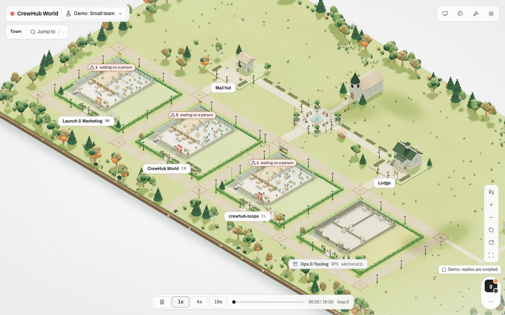

What it is not:

- **Not a second source of truth.** Every fact on screen is a loops fact (a project, a board card, an agent, the team
  snapshot, an event). The world keeps no facts of its own beyond a small presentation memory (which drone is in the
  air, which card was seen) and the town document a person draws in build mode.
- **Not a control.** Nothing in the world starts, stops, wakes or steers an agent. The one optional "director" moves
  the world's own figures and is off by default (section 2.10).
- **Read-only by construction, not by promise.** In live mode the browser never talks to loops. It talks to a small
  relay, `apps/host`, which holds the one key and forwards an allow-list of `GET` paths only (`apps/host/src/allowList.ts`:
  health, `auth/me`, events and the stream, projects, features, milestones, releases, boards, tickets, comments,
  progress, principals, agents, team, watchdog). Every other method answers 405 and never reaches loops; a test sends
  them. The key is never in a response, a log or the bundle (tests grep every response and log line).
- **No model call, anywhere.** `scripts/scan-model-calls.ts` runs in `npm test` and fails on an AI SDK import or a model
  endpoint. Rendering, motion and status need none ([COST_POLICY.md](COST_POLICY.md)).
- **Nothing of loops changes.** The world runs against crewhub-loops `4cdcd383` as the Mac app ships it. What would
  make it better on the loops side is written as proposals (section 8), not merged.

## 2. The town, in order of what you meet

### 2.1 The town

One building per project, on a town plan that grows with the project count: a clearing for none, a hamlet (one or a
few buildings, a lodge and a mail hut), a village or a town (every building, a town hall and a post office on two civic
lots and a square), and a region of districts when there are many (`apps/world/src/world/townPlan.ts`, `TIER_WORDS`).
The home view is an orthographic overview; a click on a building enters it. A project's colour and icon from loops
become a striped awning, a flag and an emblem on a plinth by the door.

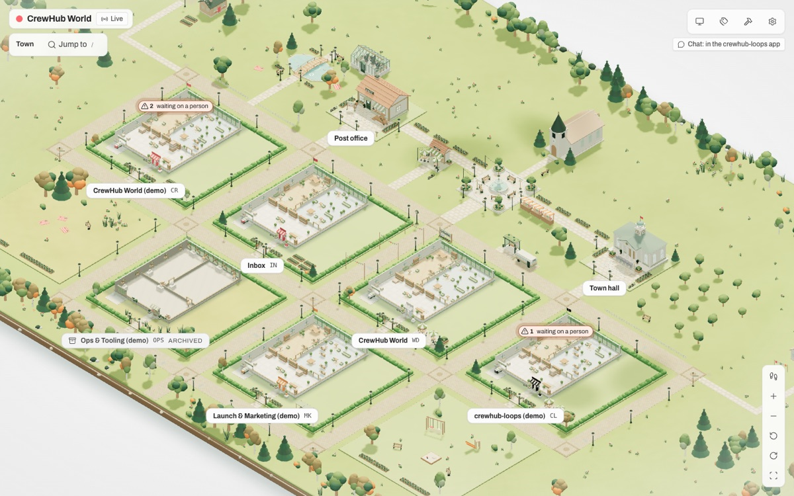

Who stands outside the buildings: agents that are registered but work in no project of the town (and every other
external bot) stand in the **town hall** (the lodge in a hamlet). The **postman** stands at the post office with its letters and
walks its rounds to the buildings' mailboxes: it is loops' deliveries made visible (`packages/world-model/src/describe.ts`, the
mailbox lines). The world's own key, the external bot the host reads with, is the **observer**: it is listed by loops
among the agents, but the world never draws it and the text view says why.

### 2.2 A building and its three rooms

Inside, a building has three halls (`packages/world-model/src/halls.ts`): **Administration** by the front door, **the
floor**, and the **lead's office** at the back. Administration carries four racks on its north wall, one per status:
Backlog, Planning, Review and Done; the floor holds the workers' desks (and the analysts' and designers' when such agents
have been present); the lead sits in the office. A classic one-room-per-kind layout still exists behind `?rooms=classic`.

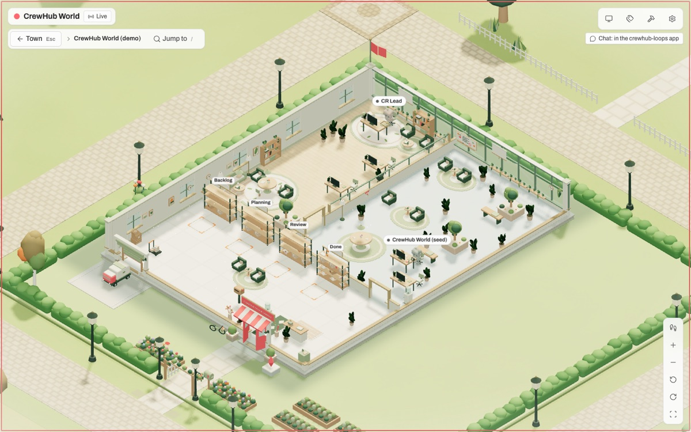

### 2.3 Racks and packages

A ticket is a package. Its **kind** decides its look (`packages/world-model/src/objects.ts`): a task is a folder, a
feature a box, a bug a bug crate, a question or a grill an envelope. Its **status** decides where it lies: backlog,
planned, review and done go to their racks; an in-progress ticket lies on the desk of its assignee (or of the worker
whose status line names the ticket, or on the lead's desk when nobody holds it). A status change is carried by a small
**drone** inside the building (`flights.ts`): the package stays where it was until the drone drops it, so a move is seen,
not guessed. A ticket archived from Done goes with the truck at the dock; an archive counter in Administration keeps the
count.

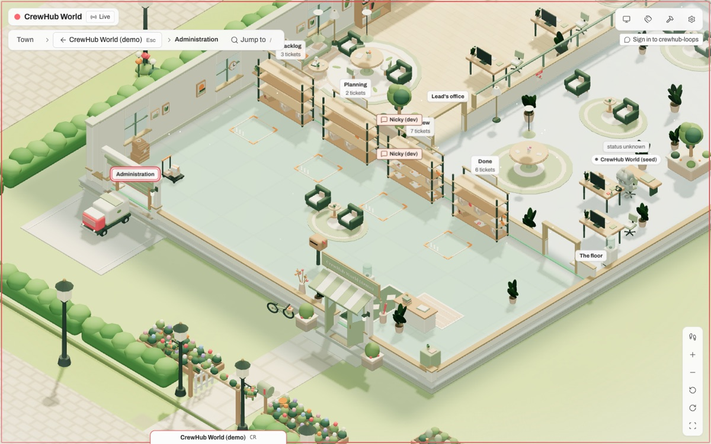

Small facts ride on the packages: a new comment is a speech mark for twenty seconds; a ticket labelled `awaiting-deploy`
wears a rocket sticker; a ticket waiting on a person wears a "waits on <name>" tag; a stalled ticket (loops' watchdog)
dims the desk lamp, and a stall that needs attention lights an amber beacon over the lead's office
(`packages/world-model/src/ruleProps.ts`, `reducer.ts`). Other rule props stand in the rooms: a banner in the lobby per
active milestone, a crate in Dispatch per draft release, a trophy on the lead's desk per published release, a bug jar
counting the open bugs.

### 2.4 Figures and casts

Agents are figures. Their **role** chooses their room (a lead in the office, workers on the floor; `agents.ts`,
`roomOfRole`), their **lane status** from the team snapshot chooses their posture: working is focused, idle and done are
relaxed, blocked is a raised hand, unknown is greyed out (`postureOf`). A progress line becomes a caption over the head
for twenty seconds. Without a team probe (the development instance has none) loops answers an empty snapshot and every
agent is "status unknown", which the text view says in those words.

The figures are a **cast**, a seam of their own: four casts ship (Classic bots, Overgrown bots, Sprouts, Potlings;
`packages/cast-*`), a building wears its own cast, else its zone's, else the viewer's choice, else the town's. A figure
too small for a desk brings its own perch. Only `apps/world/src/world/cast.ts` imports a cast package; a test enforces
it ([WORLD_STYLES.md](WORLD_STYLES.md), "Casts").

A click on a figure opens the **agent card**: where it is, when loops last saw it, its work ticket with the lane facts,
its latest progress line, and in live mode a Chat button ([AGENT_CARD.md](AGENT_CARD.md)).

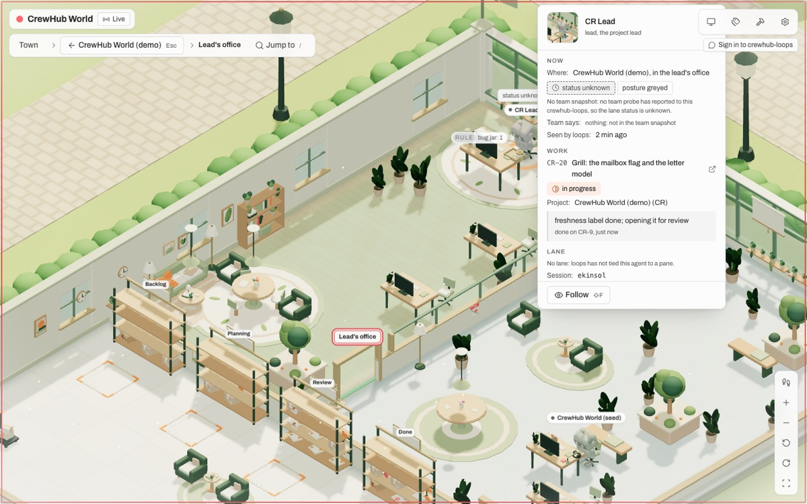

### 2.5 Persons

A move into Done is a person's act in loops (an agent's answers 403 `human_only_done`), so the world shows a **person**:
a plain figure of the building's cast, clearly no agent, comes in by the front door, takes the package from its rack or
desk, carries it to the Done rack and leaves. One person per building at a time, a queue of three behind it; the text
view and the Where form tell it; a click says who and what. Each cast brings its own person figure (`person.json`); the
walk-mode visitor is the same figure.

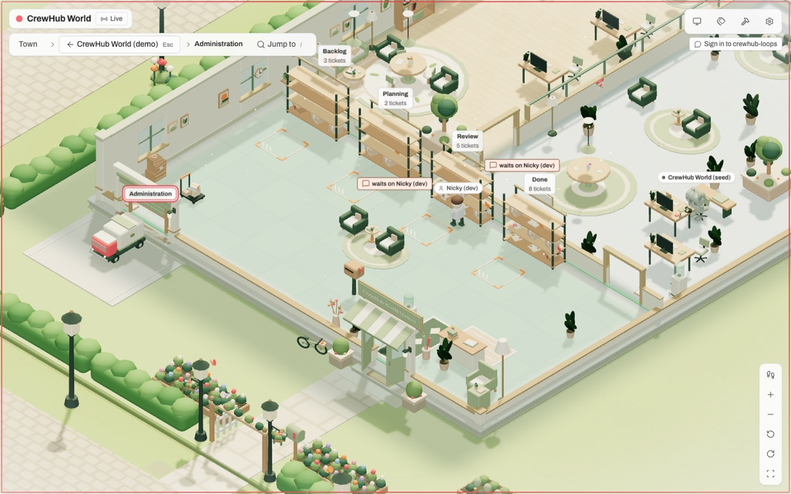

### 2.6 Zones

A zone is a level above projects, drawn as a district of the town with its own look. crewhub-loops has no project
groups yet (proposal L22), so today a zone comes from the town document a person draws in **build mode** (press B): the
live town is kept per crewhub-loops installation in that browser, never mixed with another installation or with the
demo, and the panel, build mode and the text view say "made by hand in this browser; not shared with other browsers"
(`packages/world-model/src/zones.ts`; round 11). When loops has groups, a group is a zone with the group's id and the
town document only gives it a look.

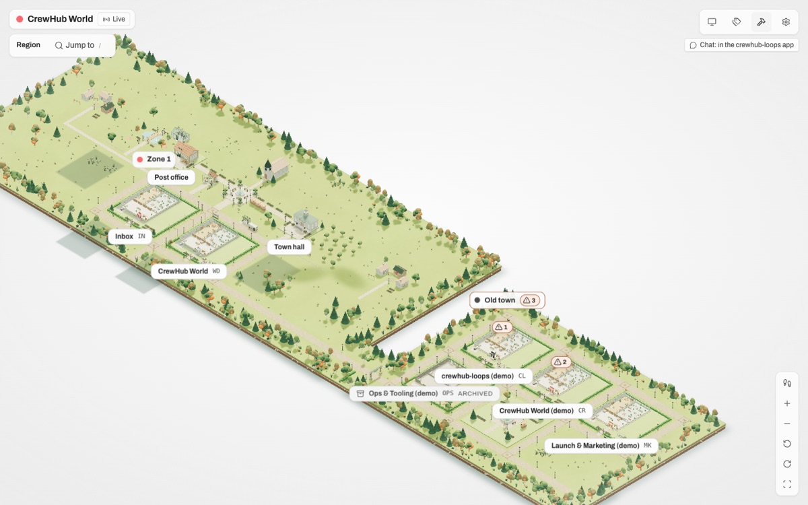

### 2.7 Closed buildings

An archived project is a **closed building**: boarded up, its lights off, a Closed sign with the archive date, no
packages and no agents, still enterable. `project.archived` plays a short closing, `project.restored` the reverse. Since
loops does not list archived projects to an agent key, the host learns the slugs from the event log
(`project.archived`, `project.restored`) and remembers them in its own folder (`archived.json`) for a loops that will
not read its log from the start.

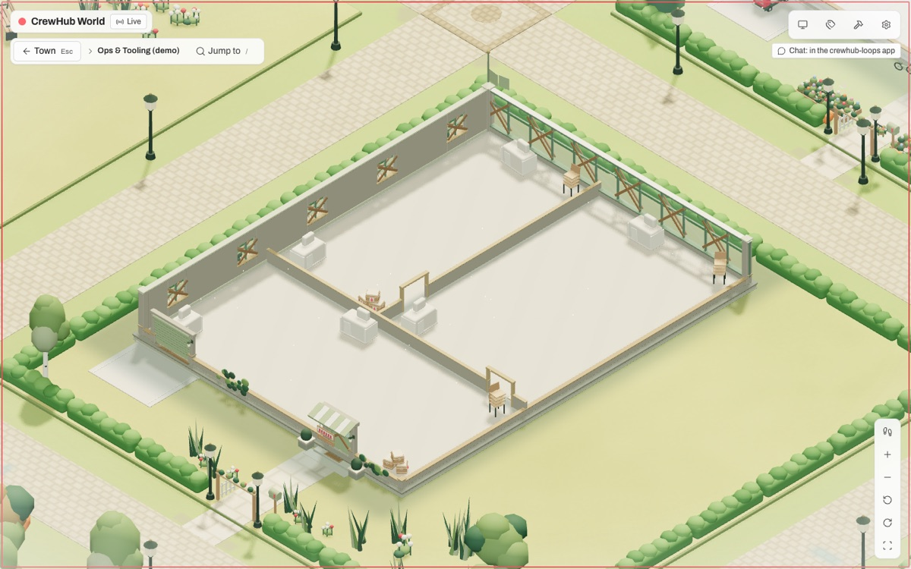

### 2.8 Dust

loops' quiet job emits `ticket.quiet` when a ticket has sat in a status without a person's or an agent's activity. The
package gathers **dust**: an unlit grey veil in the style's own colours, a few motes before its face (none under reduced
motion), and a clock tag "quiet 15 min" (`apps/world/src/world/dust.ts`). The dust stays until a person or an agent next
touches the ticket; an automation's own write, which loops stamps as `system`, does not lift it, because that write
lands milliseconds after the fact and nobody would ever see the dust otherwise. A fresh tab shows it too: the host reads
the open quiet stretches from the event log at snapshot time (section 5).

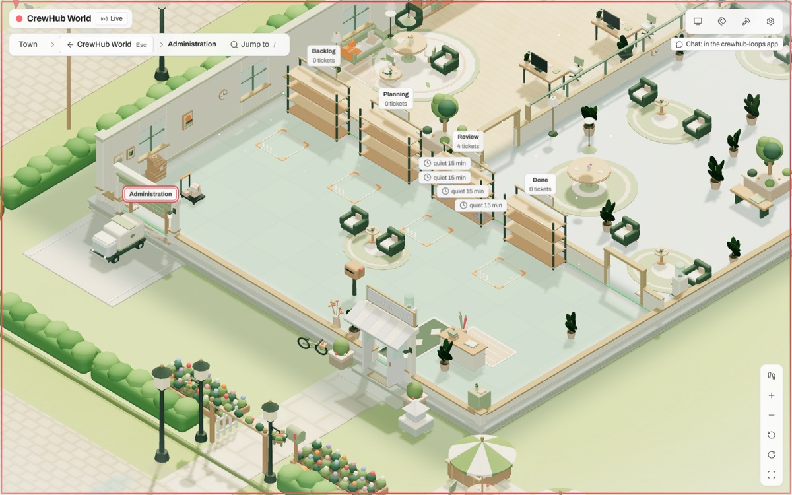

### 2.9 The board

Every `automation.ran` pins a small **card on the board by the front door** for eight seconds of source time
("Automation 'Label stale bugs' ran on WD-2: done; labels changed by the automation"), the cards queue four deep, a
failed run says so in words, and the text view keeps the last three runs as lines (`packages/world-model/src/board.ts`).

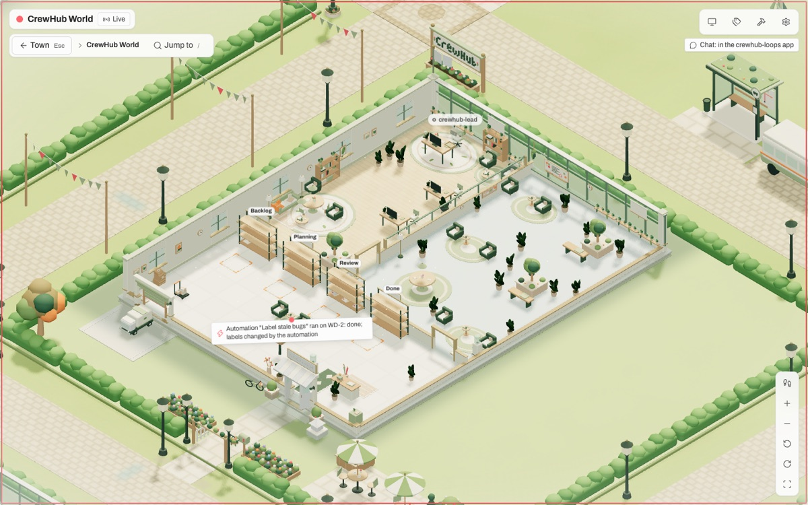

### 2.10 The director

The **director** is a scripted intent feed: at most eight intents per building per plan, from a closed list
(`goToProp`, `visitAgent`, `gather`, `stay`), validated before anything moves, never a working, blocked, stalled or
waiting agent, never a word of speech (`packages/world-model/src/director.ts`). It moves only the world's figures. It is
off by default in the demo and, since round 11, available in live mode behind its own opt-in, planning from the live
facts, with "scripted" on every intent line, in the text view and in the director log. The planned real director on a
model is not built ([ROADMAP.md](ROADMAP.md), "Open").

## 3. One table: a loops object or event, and the thing it becomes

| In crewhub-loops | In the world |
| --- | --- |
| A project | A building; its colour and icon the awning, the flag and the emblem by the door |
| `project.archived`, `project.restored` | A closed building (boards, lights off, a Closed sign with the date); the reverse |
| A project group (none at `4cdcd383`) | A zone, a district of the town; until then zones are drawn by hand in build mode |
| A ticket (kind task, feature, bug, question, grill) | A package: folder, box, bug crate, envelope, envelope |
| A ticket's status (backlog, planned, review, done) | The rack it lies on in Administration |
| A ticket in progress with an assignee | The package on that agent's desk (a worker whose status line names the key is more specific than its lead) |
| `ticket.moved` by an agent | The drone carries the package to its new place |
| `ticket.moved` into Done by a person | A person figure carries the package to the Done rack |
| A ticket archived from Done | Gone with the truck at the dock; the archive counter keeps the count |
| `comment.created` on a ticket | A speech mark over the package for 20 s |
| A progress line | A caption over the agent's head for 20 s |
| A ticket waiting on a person | A "waits on <name>" tag; a need pin on the building's sign in the town |
| The watchdog: a stalled ticket; one that needs attention | The desk lamp dimmed; an amber beacon over the lead's office |
| The label `awaiting-deploy` | A rocket sticker on the package |
| The label `prop` with a `json` block in a comment, closed by a person | A prop request: the prop enters the town's catalogue (`propRequests.ts`) |
| An active milestone | A banner in the lobby |
| A draft release; a published release | A crate in Dispatch; a trophy on the lead's desk |
| Open bugs | A bug jar on the lead's desk, counted |
| An agent (role lead, worker, analyst, design) | A figure in the office or on the floor; its cast is the building's |
| An external bot (another one) | A figure in the town hall; the host's own bot is the observer and is never drawn |
| The team snapshot's lane status | The posture: focused, relaxed, raised hand, greyed out ("status unknown" without a probe) |
| A delivery | A flagged letter in the building's mailbox; the postman walks them to the post office |
| `ticket.quiet` | Dust on the package and a clock tag, until a person or an agent touches the ticket |
| `automation.ran` | A card on the board by the front door for 8 s; the last three as text lines |
| `owner-request.updated` | Nothing: loops serves it to the owner only, and the world's key never receives it |
| A DM thread, `dm.*` | In the demo, a speech bubble over the agent; live, the Chat panel (section 6) |
| A person (a principal of kind user) | Shown only when they act: the carry into Done; the walk-mode visitor is the same figure |

## 4. Demo mode, live mode, and the fake

The world runs **two sources through one model**: `DemoSource | HostSource -> Projection -> reduceWorld -> renderer /
describeWorld`. Both emit loops-shaped envelopes with increasing `seq`; the model never knows which one feeds it
([ARCHITECTURE.md](ARCHITECTURE.md), "What is built").

- **Demo mode** is the default and needs nothing: a scripted in-browser crewhub-loops (`packages/demo`) with a sixteen-
  minute storyline and four scenarios (Fresh install, One project, Small team, Studio with twenty projects in four
  groups), a playback bar, its own lanes, the world's key as its observer and a CI bot, the quiet and automation events,
  and a scripted chat. Everything is labelled as demo. [`packages/demo/CONTENT.md`](../packages/demo/CONTENT.md) tells the
  storyline.
- **Live mode** is the same browser app against the host, which reads a real crewhub-loops. The source is decided once at
  start: `auto` is live when a host answers `/world-api/health` within 1.5 s, else demo; `?source=live|demo` overrides.
- **The fake** (`packages/loops-fake`) is the demo storyline served over HTTP the way crewhub-loops `4cdcd383` serves it
  on the wire: bearer keys, `from=tail`, sealed cursors, per-key visibility with gaps, 429 on the fifth stream, the
  archived projects in the log. The host's end-to-end test and the live browser checks run against it, and
  `npm run loops:fake -- --port 8391` lets you see live mode without any loops (never on 8091, the app's port). What the
  real loops does that the fake did not is a numbered list: [LOOPS_REAL_VS_FAKE.md](LOOPS_REAL_VS_FAKE.md).

The demo and the live town look alike on purpose: the differences that remain are by design (the playback bar, the chip,
the chat corner, the card's footer) or are the data's (lanes and a team snapshot the development loops lacks).

## 5. How to run it, and how it connects

**The morning is three steps** ([LOOPS_SETUP.md](LOOPS_SETUP.md), the first section). With `Crewhub.app` open:

1. `npm ci` once, then `npm run world`. It starts the host on `127.0.0.1:5180`, opens your browser on a one-time pairing
   link, and builds the world beside it when the build is missing or stale.
2. The world shows **Connect**: it has found crewhub-loops and has no key. In the app, Settings > Agents > New external
   bot, name `crewhub-world`, Read only unticked, member of no project; copy the key it shows once.
3. Paste it in the Connect screen. The host checks it with loops, stores it (0600, in its own folder), and the chip says
   **Live**. `npm run host -- doctor` says which step was missed, one line per check.

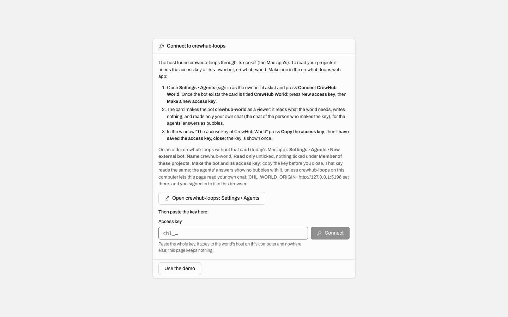

Rehearsed from a fresh clone seven times during the night; on 2026-10-21 at 18:50 Nicky ran it against his own
Crewhub.app: loops found through the app's socket, the key ok, the stream ok, three projects in fifteen reads
([the night report](reports/2026-10-01-world-demo-night.md), round 11). For development there is `npm run dev` (the
demo on `127.0.0.1:5173`), and `npm run host` with Vite proxying `/world-api` to it.

**How it connects** (`apps/host`, one Node process without dependencies, loopback only):

- **Discovery.** The env's URL or socket is taken as given; else the host reads the Mac app's data folder (never
  writes it): the Unix socket `run/api.sock`, then the port in `settings.json`, each probed with the public
  `GET /api/health`; nothing found, it looks again every 5 s, so opening the app later needs no restart.
- **The key is an external bot's.** At `4cdcd383` the only key that may read projects, boards, the team, agents,
  tickets and the event stream without a lane is an external bot (CL-314); the Read-only bot (CL-313) reads tickets of
  its member projects only, and a probe key reads nothing since CL-295. Said plainly: this key could write. What keeps
  the world read-only is the host's `GET`-only allow-list, and that is why a **viewer key** is proposed (section 8).
  Every key is checked with `GET /api/auth/me` and one board read; a wrong kind of key is rejected with the loops web's
  own words. A rejected key is never confused with loops being down: only a definite 401 or 403 from a loops whose
  health answers rejects, and a rejected key then waits (no retries) and is asked about again every five minutes, so a
  bot re-enabled in loops comes back by itself.
- **What the host does.** It assembles the snapshot the way `read-model.md` says (the stream's position first, then
  projects, boards, principals, agents, team, watchdog, milestones and releases; the archived projects and, since round
  9, the open quiet stretches and the latest automation runs from the event log), reads in parallel under a cap, names
  its own principal as the observer, and keeps **one upstream stream** `GET /api/events/stream` for every tab, opened
  from `from=tail` with loops' sealed cursor, reconnected after loops' 300 s end with jitter, with a ring buffer of 2000
  envelopes to catch a tab up. The tabs get Server-Sent Events. It pairs each browser once with a one-time link and an
  `HttpOnly` cookie, and checks the `Host` and `Origin` headers of every request.
- **What the host never does.** It never writes to loops (its only writes are the stored key, the pairing secret and
  the archive memory in its own folder), never logs or echoes the key, never holds a provider secret, never opens a
  second upstream stream, and never guesses a socket outside the app's data folder.
- **The states are honest.** Health says where loops was found, what the key's state is (none, unchecked, checking,
  rejected, ok), how the stream is, how far the first snapshot is; the world shows one screen per state (No loops
  found, Pair this browser, Connect, Checking, Key rejected, Loops down) and, once the town runs, a chip (Live,
  Catching up, Stale, Loops down, Stream busy, Pair again) that opens the **Connection panel**.

Operations have been rehearsed under a running host: loops stopped and started (Loops down, then Live again without a
reload), the key revoked while Live (the Key rejected screen over the live tab; a new key pasted brings the town back),
and loops upgraded (the panel names the old and the new version). A regress group, `ops`, plays all three over the fake.

## 6. The chat, as built

The world's own chat is phase 2 of the plan and needs CORS in loops (L8), which does not exist at `4cdcd383`; the demo
keeps a scripted dock with speech bubbles. For live mode, round 12 built **road A**: a **Chat panel** that frames
crewhub-loops' own web app in the world (`apps/world/src/components/ChatPanel.tsx`, `state/chatPanel.ts`). It opens from
the Chat chip at the top right of a live town and from an agent's card ("Chat with <name>"). Inside the frame is loops'
own app shell with its chat dock, so the chat is exactly loops' because it is loops: the person is signed in to loops in
the same browser, the session cookie is `SameSite=Lax`, and `127.0.0.1:<world>` and `127.0.0.1:8091` are one site, so
the cookie travels into the frame; signed out, loops' own sign-in shows inside it.

The panel's words are honest, because two things are true today: opened from a card, the frame asks loops for that
agent's chat (`?chat=<agent id>`, which a loops of world/viewer-key cb163004 or later turns into its dock's own open
and an older loops ignores), so the panel also says which head to open; and it needs the person signed in with loops'
bubbles feature on. The world handles no password and keeps no session; the frame's
sandbox is no wider than the chat needs (`CHAT_FRAME_SANDBOX`, each token with its reason), it never gets
`allow-top-navigation` or `allow-modals`, and "Open in the crewhub-loops app" stays beside the frame as the fallback.
Escape closes the panel while the focus is outside the frame; the focus returns to the opener.

**Road B**, speech bubbles over the figures when an agent answers, needs the person's own view of the conversation (the
world's key is not a participant of the person's thread, so it never sees `dm.*` for it). The spec addendum weighs the
options; the one that needs no loops change (the host signed in as the person, for chat reads only, off by default) is
**in progress** and not merged at this head. The honest road is on the loops side (section 8).

## 7. The text view and accessibility

Every fact the scene shows is also a sentence. The **text view** (press T) describes the whole world as text: the
connection line, each building with its racks and desks and what lies on them, who is where in which posture, the
persons, the closed buildings, the dust, the board's last runs, the zones, the director's log
(`packages/world-model/src/describe.ts`). A **Where is …?** form answers for one agent in zone labels, never
coordinates (`where.ts`). The jump list (`/`) names every building; Details (D) shows every label; W begins walk mode;
Escape backs out of anything.

What a screen reader is given was checked in round 8 (`tools/a11y.mjs`): one live region per Connect screen that says
the screen once and nothing that ticks; a connection change over the town said once; the Connection panel's facts as a
definition list; Tab reaching every control with a focus style, Enter on the chip opening the panel with the focus
inside and Escape giving it back; pills and tags saying in words what a colour showed ("CR-17 waits on Nicky", "CR-17
quiet 30 min", a lane status on the agent pill); links that open a new tab saying so; text contrast at or above 4.5:1
on every screen in both themes; no horizontal scroll and 40 px controls on a phone; reduced motion honoured (the drone
and the person land at once, the checking icon stops, the dust shows no motes). Colour is never the only signal.

## 8. What is proposed on the loops side, and why

Nothing of this is merged in crewhub-loops. It lives on the branch `world/viewer-key` of a loops checkout (eleven
commits on `4cdcd383` when this was written, more as the chat asks land), with tests, and three proposal pages for `cl-lead` under `docs/proposals/` there. The world runs
without any of it; each item would make it more honest or more direct.

- **The viewer key** (gap L1; `crewhub-world-viewer.md`). A third kind of external bot, `agents.viewer`: its key opens
  exactly the table of `GET` routes the world's host reads, for the whole installation, and nothing else; every other
  route and method is 403 before the route runs; paced and logged like the reader. Why: today the world holds a plain
  lead's key that could write tickets and comments in any project, and only the host's allow-list stands between that
  key and a write. A page that only looks should hold a credential that cannot do more.
- **The "Connect CrewHub World" card** (the same page). One button in Settings > Agents makes the bot `crewhub-world`
  as a viewer, with no project, and shows its key once with where to paste it, so steps 2 and 3 of the morning become
  one dialog. The key is still pasted in the world's Connect screen; nothing hands it to the host behind the person's
  back.
- **Page two** (`crewhub-world-viewer-2.md`): a `ticket=` filter on `GET /api/events` (and the stream), so a fresh
  tab's quiet stretches are decided by one tiny read per ticket instead of a capped scan of everyone's activity; and
  `includeArchived=true` for a viewer key, so closed buildings come from the list, not from the whole log and a memory
  file.
- **Page three** (`crewhub-world-viewer-3.md`): chat with the agents, three asks. (1) `?chat=<agent>` on the web app,
  about ten lines, so the Chat panel can open the right head; (2) the person's DM threads for the viewer key, read only;
  (3) CORS for the world's loopback origin on the DM read routes only, with the writes still refused by loops' Origin
  guard. The page recommends (3), then (1), and not (2): the viewer key's worth is that it cannot read what a page does
  not need, and the person's chat is the clearest case. **These asks are being turned into code on `world/viewer-key`
  now** (a deep link to one agent's chat, an explicit framing allowance for loopback origins, the smallest honest chat
  read for the viewer), each small, tested and reversible, for cl-lead to weigh; crewy pushes the branch when Nicky says.
- **The older proposals** of the plan (L2 to L8, L22: project groups) stand as written in
  [LOOPS_GAP_ANALYSIS.md](LOOPS_GAP_ANALYSIS.md), section 6.

## 9. Where to read next

- [ARCHITECTURE.md](ARCHITECTURE.md): the packages, the host's parts, the world's gate and screens, the first frame in
  order, the events.
- [LOOPS_SETUP.md](LOOPS_SETUP.md): the runbook for the Mac app; the morning in three steps, then the reference (the
  env, the commands, the health read, what each chip and screen means, the developers' private loops).
- [ROADMAP.md](ROADMAP.md): what is built, in demo and live mode, round by round; what is open; what waits for Nicky.
- [The night report](reports/2026-10-01-world-demo-night.md): what was built per round, how it was verified, and the
  challenges met in loops' integrator docs.
- [The demo-mode spec and its addenda](superpowers/specs/2026-10-01-world-demo-mode-design.md): the design of every
  part, including "chat with the agents" and the proposal for project groups and the live director.
- [LOOPS_REAL_VS_FAKE.md](LOOPS_REAL_VS_FAKE.md), [LOOPS_GAP_ANALYSIS.md](LOOPS_GAP_ANALYSIS.md),
  [LOOPS_INTEGRATION_PLAN.md](LOOPS_INTEGRATION_PLAN.md): the wire, the gaps, the plan.
- [tools/README.md](../tools/README.md): the browser checks (the regress pass in seven groups), the measurements, the
  accessibility pass, the seed and the development crewhub-loops.
