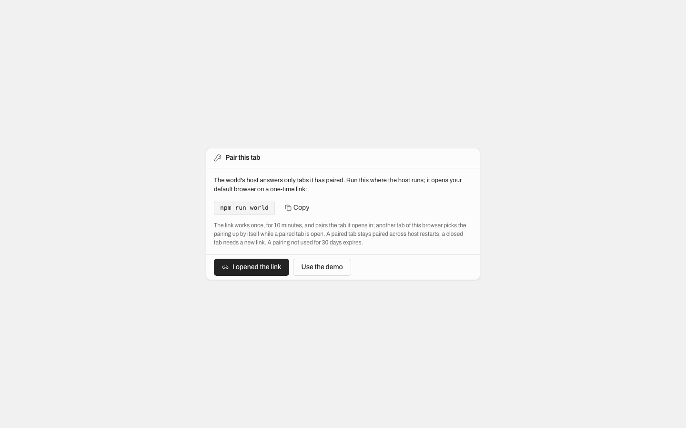
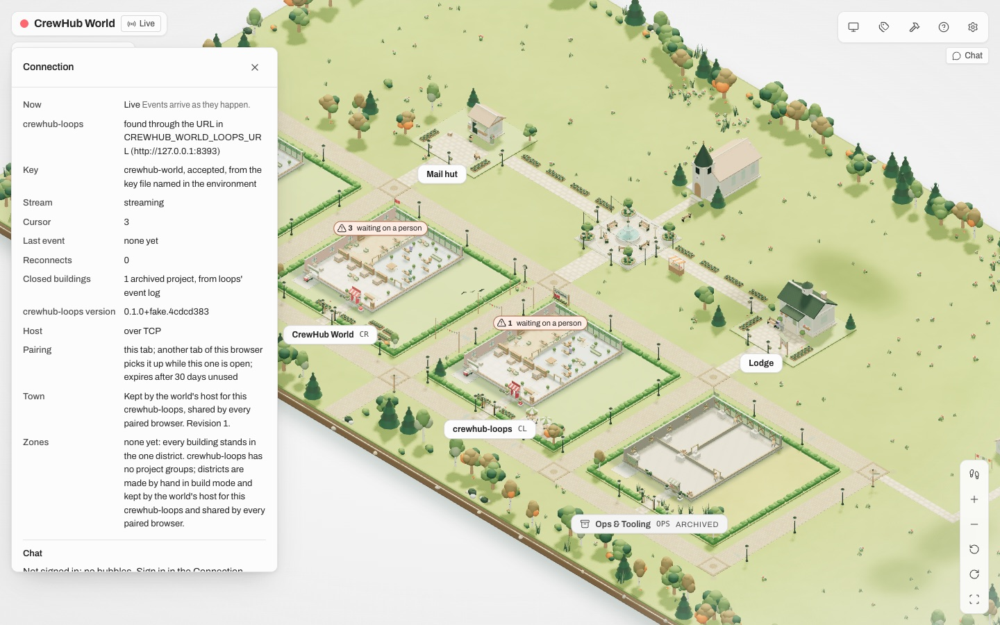

# Pairing per tab: the cookie today against a per-tab bearer (round 27, a proposal)

**Status: a proposal on `task/r27-tab-pairing`, never merged.** Built so the two design questions of the host's
security review (round 26, Medium 1 and "should a pairing expire?") can be answered with facts. The branch runs: the
host, the page, the tools and the tests are on the per-tab road there; `feat/world-demo` keeps the cookie.

## What each road is

| | **Today: the cookie** (`feat/world-demo`) | **Per tab: the bearer** (this branch) |
| --- | --- | --- |
| The link | `http://127.0.0.1:5180/pair/<token>`: the host redeems it and sets a cookie, `303 /` | `http://127.0.0.1:5180/#pair=<token>`: the token sits in the fragment, which a browser never sends to a server; the page takes it out of the URL and exchanges it at `POST /world-api/pair` for the tab's bearer |
| Where the pairing lives | an `HttpOnly; SameSite=Strict; Path=/` cookie on `127.0.0.1`, attached by the browser to every request to any loopback port | the tab's `sessionStorage`; sent by the page in its own `x-world-pair` header on every host request, the stream included (the source streams with fetch) |
| What a local program on **another loopback port** can do, if the paired browser visits it | it receives the cookie on every request (RFC 6265: cookies ignore ports) and can read and write everything with it; it can also set a junk cookie that locks the browser out (review Medium 1, Medium 2; the lock-out is fixed since round 26) | nothing: a page on another port never sees the header, the browser attaches nothing on its own; sessionStorage is per origin |
| Cross-site requests (CSRF) | blocked by SameSite=Strict, the Origin guard and the JSON preflight | cannot carry the pairing at all; the Origin guard and the preflight stay as a second line |
| Expiry | none: a browser that restores session cookies stays paired for ever | a bearer unused for `CREWHUB_WORLD_PAIRING_IDLE_DAYS` (default 30, 0 never) is refused; the window slides with every use; the Pair page and the Connection panel say the number |

## What a person does

Steps counted as "a command or a click a person makes"; the page's own work is not a step.

| Situation | Today: the cookie | Per tab: the bearer |
| --- | --- | --- |
| First pairing | 1 (`npm run world` opens the link; the page is Live) | 1 (the same; the page lands on `/`, the fragment gone, Live) |
| A second tab of the same browser | 0 (the cookie is there) | 0: the new tab asks the open tabs over a BroadcastChannel and is Live by itself (measured: 319 to 350 ms from the navigation, page load included) |
| A reload | 0 | 0 (sessionStorage survives a reload) |
| A host restart (`npm run world` keeps the secret) | 0 | 0: both open tabs went Live again by themselves (measured) |
| A host restart without the secret file (`npm run host`) | 1: a new link | 1: a new link |
| A browser restart | 0 with "continue where you left off", else 1 | 0 when the browser restores its tabs (Chrome and Safari keep sessionStorage for restored tabs), else 1 |
| The tab closed, a new one opened later, no other tab open | 0 | 1: the Pair page, a new link (`npm run world` or `npm run host -- open`) |
| A new link opened while a Pair-page tab is open | 1 (the link); the old tab needs a reload | 1 (the link); the old tab picks the pairing up by itself within one health poll (measured: 808 ms, no click; "I opened the link" asks at once) |
| Another browser or a phone | 1: a new link | 1: a new link |
| The Vite dev road (`npm run dev` + `npm run host`) | the cookie works across ports (5173 and 5180) | the link is minted on the Vite origin (`npm run host -- open --origin http://127.0.0.1:5173`, as today); the header rides through the proxy; a tab is paired per origin |

Pictures (light, 1440), as the branch draws them:

## Code size

The branch against `4d635b6`: sources 12 files changed, 157 insertions(+), 81 deletions(-), plus 138 lines in two new files; tests 3 files changed, 100 insertions(+), 95 deletions(-), plus 64 lines in two new test files; docs 2 files changed, 62 insertions(+), 71 deletions(-); tools 2 files changed, 7 insertions(+), 7 deletions(-) (words only). New: `packages/loops-client/src/pairingBearer.ts` (the
fragment, the storage, the header, the hand-off), `apps/world/src/state/pairing.ts` (the start plan, pure). Changed:
`apps/host/src/pairing.ts` (bearer, idle window, no cookie), `host.ts` (`POST /world-api/pair`, the gate reads the
header), `config.ts` and `main.ts` (the idle days), the client's five host calls, `main.tsx` (the start), the Pair
page and the panel's words, the host README, the runbook, the regress and a11y tools' words, the tests.

## Risks and what was not built

- **A closed tab is unpaired.** This is the road's price: a person who closes the last tab and comes back the next day
  without tab restore needs a new link (one command). The cookie never asked again.
- **Tab restore keeps the bearer**, so "a browser restart" is 0 steps on Chrome and Safari with their usual settings:
  the expiry (30 days unused) is then the only end of a pairing, as with the cookie plus the idle window.
- **The last use is in the host's memory**: after a host restart the idle window starts again at the first use (never
  shorter than the setting; a pairing that was already idle for 29 days gets another 30). Writing the last use beside the
  pairing secret would close that; not done.
- **The hand-off trusts any paired tab of the origin** (BroadcastChannel is per origin): a page on the same origin is
  the world itself; no other origin can ask.
- **The old `/pair/<token>` links** (printed by an older host or kept in a terminal) are not understood by this host:
  they land on the app's page and the Pair page shows; the link is a new one anyway.
- Not built: a "link for another tab or browser" button in the panel (a paired tab minting a fresh link), a persisted
  last-use file, an expiry notice before it happens.

## Recommendation

**Per tab, with the 30-day idle expiry**, if "another local program the person's browser visits" is inside the threat
model (review question 1). It costs one extra step in exactly one situation (the last tab closed, no restore), and it
removes the cookie's two real exposures (every loopback port receives it; it never expires) without a new one. If that
threat is accepted as the Mac's own boundary, keep the cookie and add only the expiry (`Max-Age` plus a sliding
re-issue): the branch's expiry code is the same shape either way.
