# Walkthroughs for Nicky (round 64, 2026-11-05)

Six fresh walkers met the world as a person does, each on the production build of `d2a9ead2` in a headless Chromium
with the fake crewhub-loops behind a host of their own: **1** first start (w1), **2** connecting (w2), **3** chat (w3),
**4** a phone (w4: an iPhone 13 and a Pixel 5 profile, thumbs only), **5** keyboard and screen reader (w5),
**6** the town editor (w6). None had built the page parts they walked. This page keeps what they found **confusing**
or **polish**, by journey, each with a one-line suggestion and, where a picture says more than the sentence, a picture; what was plainly broken was fixed in the same
round (the table below). A finding that is an open choice in [design-choices.md](design-choices.md) is not restated:
[the last section](#what-the-walks-added-to-the-open-design-choices) says only what the walks added to it.

**How to read it.** `w3-1` is walker 3's first finding; the walkers' full reports (steps, timings, selectors) are the
round's reports, not in the repository. **Nothing changes until you say so;** a suggestion is one way, not the way.
Prepared branches are ready; an answer `do it` merges that branch, `journey N: as suggested` merges the journey's.
**How to answer:** one line per id (`w3-1: do it`, `w6-13: as it is`, `w1-12: <your words>`), or a journey at once
(`journey 4: as suggested`).

## Fixed this round (broken findings, not in the body)

| Id | Finding | Branch | Status |
| --- | --- | --- | --- |
| w2-3 (the fake's half) | After the Mac slept an hour, the fake stamped every event an hour behind the clock | `task/r64-w2-fake-clock` | fixed (round 64) |
| w4-7 | A phone had no way to open the text view (the T key and a hidden skip link only) | `task/r64-w4-textview` | fixed (round 64) |
| w4-14 | "Loops down" cut to "Loops d" under the phone header's right corner | `task/r64-w4-phone` | fixed (round 64) |
| w4-19 | Sideways, the Agent chats menu ran off the bottom and its last items could not be reached | `task/r64-w4-phone` | fixed (round 64) |
| w5-7 | The chat dock's "Agent activity" ticket chips were invisible yet took ten Tab stops | `task/r64-w5-dock` | fixed (round 64) |
| w5-8 | The focus vanished after Send in the chat dock | `task/r64-w5-focus` | fixed (round 64) |
| w5-14 | "question as a envelope with a question mark" in the text view | `task/r64-w5-dock` | fixed (round 64) |
| w5-24 | The focus vanished on Enter at "Forget this key" | `task/r64-w5-focus` | fixed (round 64) |
| w6-1 | "Placed Oak bench in the workers." / "in the lobby": a room id, not the sign's words | `task/r64-w6-words` | fixed (round 64) |
| w6-9 / w4-17 | Settings › Zones said the zones are kept in this browser while the host kept the town | `task/r64-w6-words` | fixed (round 64) |
| L-1 (tools) | `npm run loops:fake -- --help` started a fake on 8391, a named port | `task/r64-l1-fake-args` | merged (`6b2b1f53`) |

## 1. First start: the demo, the tour, buildings and rooms, Details, the text view (w1)

- **w1-11 / w4-8 · confusing.** A click on a figure's **name pill** zooms to its room instead of opening its card
  (the pill lets the click through to the room under it; a click on the figure's body does open the card); on a phone
  the first tap on a figure zooms the room and the card needs a second tap, while the tour promises "a click on one
  opens its card". **Suggestion:** a click or tap on the pill or the figure opens the card; the room zoom stays for the floor and the signs.

  Prepared: `sugg/w1-11`.

- **w1-12 · confusing.** With Details on, three labels lead with **RULE** ("RULE milestone banner", "RULE release
  crate", "RULE bug jar: 2"), a build-mode word; a visitor reads a rule of the project. The text view says it well
  ("Banner in the lobby: milestone CR-M2 "Walkable town" is active"). 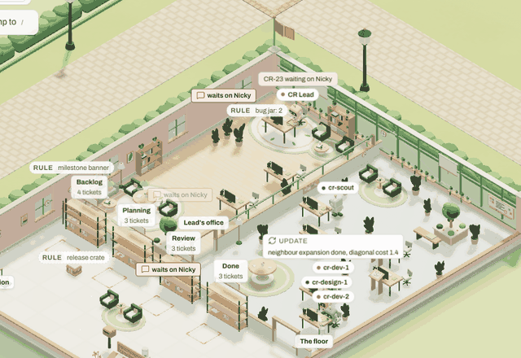 **Suggestion:** the label says the fact ("Milestone CR-M2 active", "Release 0.3.0: draft", "2 open bugs").

  Prepared: `sugg/w1-12`.

- **w1-13 · confusing.** An archived building's text says "Tickets: 2 backlog, 1 planned, 0 in progress, 0 review,
  1 done" and four lines later "Administration: Backlog 0, Planning 0, Review 0, Done 0", "The floor: quiet". (No
  picture: text.) **Suggestion:** one of the two, or a line that the boarded-up racks hold nothing because the tickets
  are archived with the project.

  Not prepared: "one of the two" does not say which line to keep.

- **w1-14 · polish.** The tour's last card (step 6) covers the breadcrumb bar ("Town · Jump to /") while it rings the
  Demo chip above. 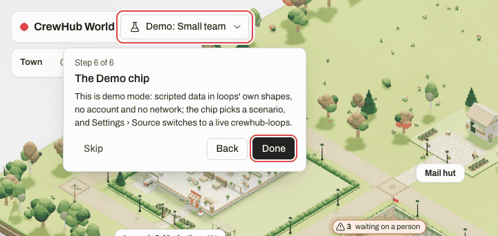 **Suggestion:** the card below the bar, or to its right.

  Prepared: `sugg/w1-14`.

- **w1-15 · polish.** A building sign has no hover state: the pointer changes and nothing else does (the sign reacts
  on focus only). **Suggestion:** a small lift or outline on hover, as on focus.

  Prepared: `sugg/w1-15`.

- **w1-16 · polish.** With Details on, label pairs touch: the two "waits on Nicky" tags by the Review rack overlap
  each other's corner (label layout, as design-choices already notes). 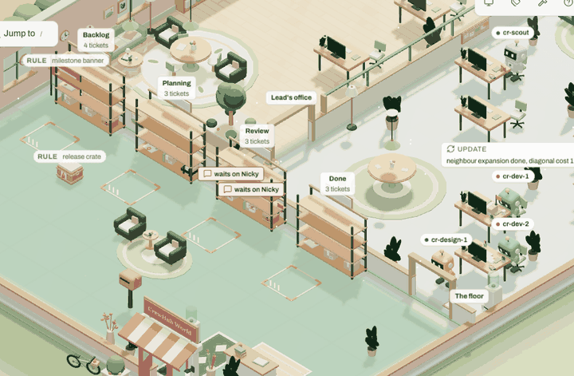 **Suggestion:** none new; the label layout's known gap.

  Not prepared: the write-up has no suggestion for it.

- **w1-17 · polish.** In walk mode the figure at the door carries "You"; once it walks through the door the tag is
  gone and the breadcrumb alone says where it is. **Suggestion:** the "You" tag follows the visitor inside, or the sheet says "You are inside CrewHub World".

  Prepared: `sugg/w1-17`; on the base the tag was hidden for about half a second at the door, not for good.

- **w1-18 · polish.** "loop 0" in the playback bar reads as a code on first start; its tooltip ("How many times the
  script has looped") never reaches a keyboard or a thumb. **Suggestion:** "loop 0" only once the script has looped, or
  a word a first visitor can place ("replay 0").

  Prepared: `sugg/w1-18`.

- **w1-19 · polish.** Fresh install's plot carries a board that says "Create a project in crewhub-loops" in letters a
  few pixels high from the home view; only the text view says it in words. 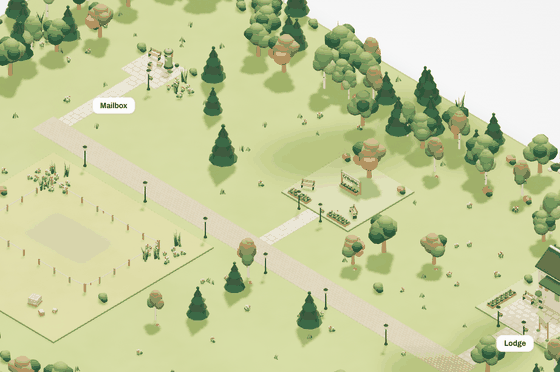 **Suggestion:** a label over the plot with the sentence, as the buildings have signs.

  Prepared: `sugg/w1-19`.

## 2. Connecting: the Connect screen, a key, Live, Forget, a second tab, the host restarting, a stale stretch (w2)

- **w2-1 · confusing.** With the tour's card and the Connection panel both open, Escape closes the tour, not the panel
  a person just opened (the focus is in the panel). **Suggestion:** Escape closes the layer that holds the focus; the tour takes Escape only while its card has it.

  Prepared: `sugg/w2-1`.

- **w2-2 / w3-7 · confusing.** Two sheets open at once: the Connection panel stays open under the text view (left and
  right), and the Chat panel and the text view stack at the same top-right corner, the lower one showing a sliver of
  cut words ("Te", "Liv", "Ch…"); at 1100 px a person cannot read the text view without closing the panel and does
  not know the first sheet is still open. 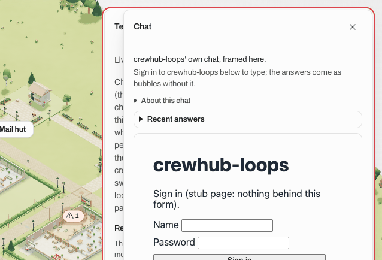 **Suggestion:** one sheet at a time (opening one closes the other), or side by side when the window is wide enough.
  Same family as design choice X2.

  Not prepared: design choice X2's family (the sheets over each other).

- **w2-3 (the page's half) · confusing.** When every event that arrives is old (the fake's clock was an hour behind
  after a sleep, now fixed), the chip says **Live** ("Events arrive as they happen") while the panel says "Last event
  1 h ago" and the text view says the snapshot is stale and every status unknown: three signals disagreeing on one
  screen. The Stale state keys on arrivals, not on the events' age. 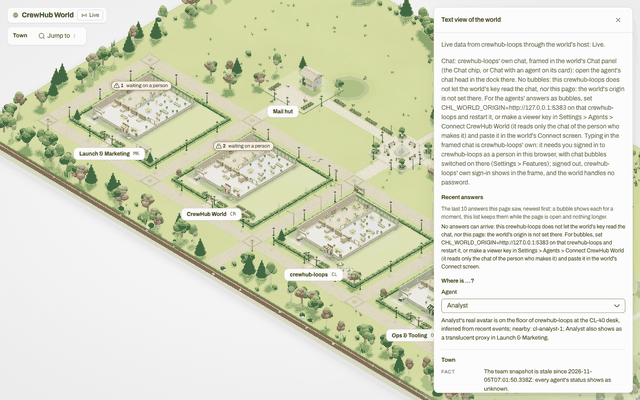 **Suggestion:** the chip goes Stale when the newest event is older than the stale threshold, whatever still arrives.

  Not prepared: a decision, design choice [L3](design-choices.md#l3-the-chip-says-live-while-the-team-snapshot-is-stale-round-66-walkthrough-w2-3) (which threshold, and whether a quiet but healthy team then reads Stale). Answer there: `L3: snapshot` is the recommended one.

- **w2-4 · polish.** The panel's crewhub-loops row breaks "CREWHUB_WORLD_LOOPS_UR / L" mid-word (a long token in a
  narrow column). 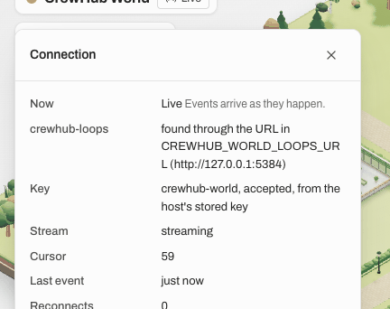 **Suggestion:** the variable name on its own unbreakable line, the URL under it.

  Prepared: `sugg/w2-4`.

- **w2-5 · confusing.** A host restart shows as "Stale: nothing has arrived for a while; the world may be behind" (the
  host is gone, loops is fine), then Live again. A person who restarted `npm run world` on purpose gets no word that
  says so. **Suggestion:** a state of its own for a refused connection to the host ("The world's host is not answering; it
  may be restarting"), the mirror of design choice L1.

  Not prepared: the mirror of design choice L1.

- **w2-6 · polish.** The browser's console shows two red lines at every Live start (the page's own chat probe at the
  loops origin: a CORS refusal and a 401) when the world's origin is not set on loops; nothing is wrong, and the panel
  says so, but a person who opens the console to look for a problem finds two. **Suggestion:** none that avoids the
  browser's CORS line; a note in LOOPS_SETUP that the two lines are expected.

  Not prepared: its LOOPS_SETUP note is already merged (round 65).

- **w2-7 · confusing.** On the Pair screen, "I opened the link" pressed before any link was opened does nothing and
  says nothing; the button looks dead (the page re-asks health every 2.5 s anyway). **Suggestion:** a line under the button: "This browser is still not paired: open the link npm run world printed first."

  Prepared: `sugg/w2-7`.

- **w2-8 · confusing.** A key with too few rights (a builder or read-only bot) is refused with "crewhub-loops refused
  the key on the event stream (401 or 403): it was revoked or its bot disabled meanwhile": the cause named is the wrong
  one for 403, and "(401 or 403)" is a status code shown to a person. **Suggestion:** two sentences, one per status: 403 "the key is alive but its bot cannot read the stream: make the bot
  with Read only unticked"; 401 "revoked or disabled". Related: design choice W15.

  Not prepared: design choice W15's family.

## 3. Chat: the panel, a thread, sending, the bubbles over the town, Recent answers, loops refusing or slow (w3)

- **w3-1 · confusing (close to broken).** An answer that comes while the camera is elsewhere (zoomed at the Lodge,
  the agent inside another building) shows nothing on screen for the 12 s it lives: the mark hangs from a building
  label that is hidden at that zoom, the Chat chip shows no count; only the text view and Recent answers have it.
  **Suggestion:** a count on the Chat chip (or the dock button) for every answer, whatever the camera shows.

  Prepared: `sugg/w3-1`.

- **w3-2 · confusing.** A bubble over a figure in the town carries no name: at the Lodge it floats between two robots
  with the text only (the name is in the title and the accessible name); inside a building the name pill sits under
  the bubble, so there it is clear. 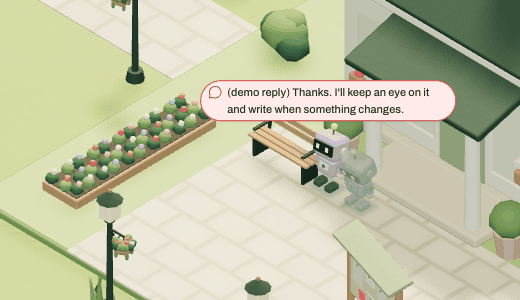 **Suggestion:** the speaker's name on the bubble (or its pill shown) whenever the pill is not drawn at that zoom.

  Prepared: `sugg/w3-2`.

- **w3-4 · polish.** The bubble's 12 s start when the page sees the line, not when the person gets there: a person who
  reads the says-line in the text view first finds the bubble and its mark gone on return. **Suggestion:** the mark
  outlives the bubble (until the answer is read or the next one comes), or the bubble's clock starts on screen.

  Prepared: `sugg/w3-4`: live, the mark stands until the chat is opened or the agent's next answer replaces it. One small
  change beyond the suggestion comes with it. Where a pin and a mark share a row, the pin's breathing ring and its touch
  area now stay on the pin: the ring is about 37 px wide at 375 px where it was 117, and about 191 at 1440 where it was
  271, so the warm ring no longer runs round a mark that now stands longer. A tap on the row still enters the same building, except
  in the 2 px between the two on a phone, where it now does nothing.

- **w3-5 · polish, wording.** "About this chat" says "Open an agent's chat head in loops' dock (the Agent chats menu at
  this width)": a newcomer does not know "chat head", "dock", or which width is meant (the frame's). **Suggestion:** "In the frame, open an agent's chat (the Agent chats menu on a narrow frame)".

  Prepared: `sugg/w3-5`.

- **w3-6 · confusing.** With loops frozen (not closed), the chip went Live, Stale at 40 s, **Live again** at 46 s
  while loops was still silent (the page reopened its stream and the host answered the open at once), then Loops down
  at 86 s; the panel at that moment said "Now Live" with "Last event 7 min ago" under it. **Suggestion:** a reopened stream does not say Live until a heartbeat or an event has come through it.

  Not prepared: already fixed and merged (round 65).

## 4. Phone: a touch device, the journeys above with thumbs only, the sheets and the controls (w4)

- **w4-2 · polish, wording.** The tour, the card, the build sheet and walk mode speak of clicks and keys to a thumb:
  "a click on a building enters it", "the jump list (/)", "the text view (T)", "Follow ⇧F", "W A S D or the arrow keys
  move you, Shift hurries, drag to look around, Escape stops" (the joystick is never named), "Enter or a click places
  it, arrow keys move it, R turns it". **Suggestion:** touch words on a touch device ("a tap", "the joystick", no key hints), chosen by the page's input kind.

  Prepared: `sugg/w4-2`, in the four places the finding names; a few spoken key hints elsewhere stay.

- **w4-3 · confusing (screen reader).** The tour's step 4 ends, for a screen reader, with "Highlighted on the screen:
  Agent chatsChat with G-Man, 0 unreadPin an agentPin CR Lead…": the phone's dock is a tall column and the step reads
  the target's every button run together. **Suggestion:** the step's own name for the target ("the chat"), the family
  of design choice T3.

  Not prepared: design choice T3's family.

- **w4-6 · polish.** A tapped sign keeps a red focus ring on a touch device: a building's expanded plate stays ringed
  in the middle of the town after "← Town", a room sign keeps its ring through walk mode, the Stale chip after a tap.
  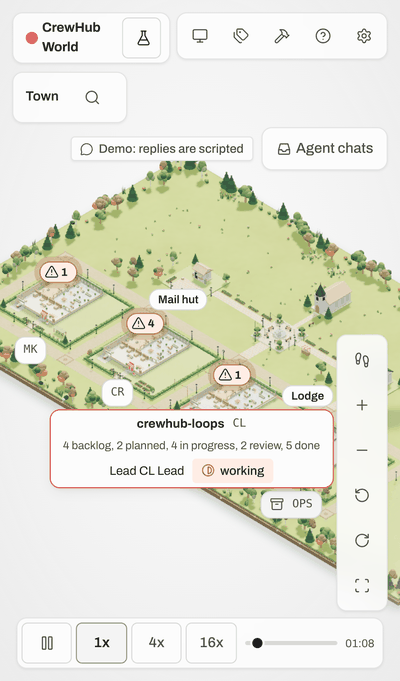 **Suggestion:** the ring on `:focus-visible` only, so a tap shows none.

  Prepared: `sugg/w4-6`.

- **w4-9 · confusing, wording.** The card's Answers section says "write to it in the demo's chat dock (bottom right)";
  on the phone the dock is the "Agent chats" button at the top right. **Suggestion:** "in the demo's chat (the dock at
  the bottom right, or Agent chats at the top on a phone)", or the place by width.

  Prepared: `sugg/w4-9`.

- **w4-10 · polish.** The playback slider is 88 px wide for a 16-minute story (four speed buttons take the bar): a
  thumb moves 11 s per pixel. 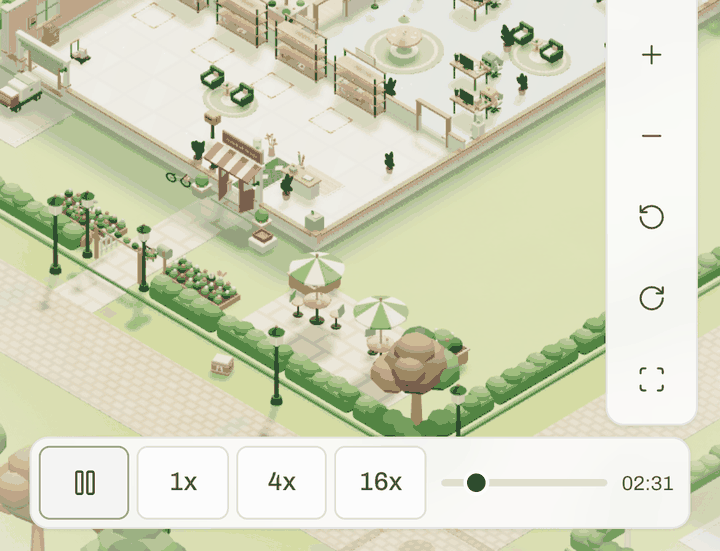 **Suggestion:** the speeds in one menu button on a phone, the slider taking the rest.

  Prepared: `sugg/w4-10`, on a phone held upright; held sideways it keeps the four buttons.

- **w4-11 · polish.** The jump to the postman frames it at the screen's left edge, half under it, the CR building
  filling the right. 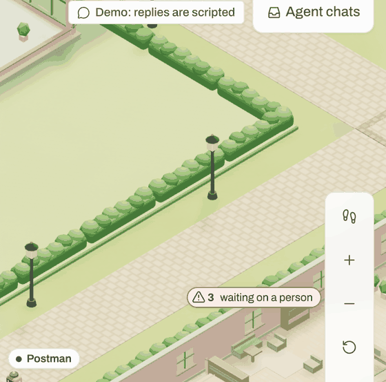 **Suggestion:** a jump to a figure centres it in the portrait frame.

  Prepared: `sugg/w4-11`; the camera also goes with the figure for 6 s, because the postman walks on while it lands.

- **w4-12 · polish.** Settings › Town's paired selects cut their words at 390 px ("Follow the town (C…", "The style's
  own (O…"), so a person cannot read what is chosen without opening each. 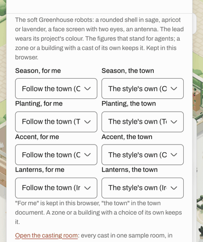 **Suggestion:** one column on a phone.

  Prepared: `sugg/w4-12`.

- **w4-18 · confusing.** Inside a building the build sheet covers the lower 45 % of the screen, where the building
  stands; a tap over the road still placed the prop in the nearest free cell, under the sheet, so the person cannot
  see what they placed without panning. 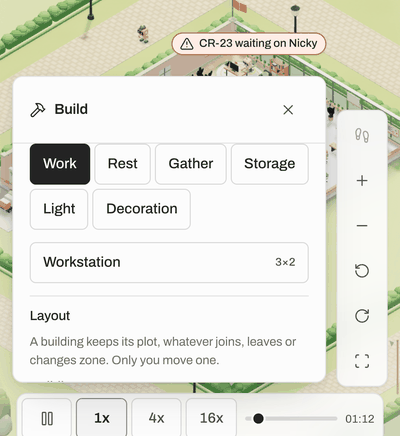 **Suggestion:** a shorter sheet (the palette only, the rest behind a tab), or the camera framing the floor above it.

  Prepared: `sugg/w4-18`, the first way; the lower floor is still partly under the sheet.

- **w4-20 · polish.** Sideways (750 x 342) inside a building the labels pile up in a staircase and the building's
  plate lies over the playback bar; label layout, worse in a short window. 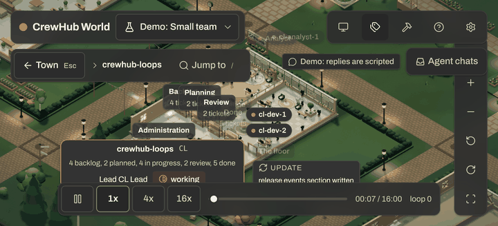 **Suggestion:** fewer labels at once in a short window (Details shows the racks' counts on demand).

  Not prepared: "fewer labels" does not say which labels.

- **w4-21 · polish.** The Chat panel's "About this chat" and "Recent answers" rows are 18 and 20 px tall, the only
  controls under 40 px in the panel; a thumb misses them. **Suggestion:** 40 px rows (a pad, as the signs have).

  Prepared: `sugg/w4-21`, real 40 px rows, not a pad.

- **w4-22 · polish.** The Chat panel says nothing when loops is down: the chip says "Loops down", the Connection panel
  "Stream down; the host retries", but the panel keeps "Sign in to crewhub-loops below to type" and a frame that cannot
  load. **Suggestion:** one line from the chip's state at the top of the panel ("crewhub-loops is not answering").

  Prepared: `sugg/w4-22`.

## 5. Keyboard and screen reader: focus order and visibility, the text view's tree, live regions (w5)

- **w5-6 · polish.** The camera keys (+, -, [, ], H) say nothing to a screen reader, while D and F say "Details on" and
  "Frame rate overlay on". **Suggestion:** one polite line each ("Zoomed in", "Rotated left", "Home view").

  Prepared: `sugg/w5-6`.

- **w5-9 · confusing.** The chat dock's message box drops keystrokes that come fast: with no pause between keys every
  other character is lost ("Where are you?" became "?"); 30 ms apart everything arrives; a paste is fine. The draft
  lives in a react-query cache that notifies React in a batch, so the controlled textarea is reset before the next
  input event is read (a verbatim loops copy). **Suggestion:** a local state for the draft, the cache written after;
  a fix in crewhub-loops first, then a re-copy.

  Not prepared: a verbatim crewhub-loops copy; the fix belongs there first.

- **w5-10 · confusing.** In the dock's message box Enter adds a newline; Cmd+Enter and Ctrl+Enter do nothing; only the
  Send button sends (a loops copy, so crewhub-loops' own choice). **Suggestion:** Enter sends and Shift+Enter breaks
  the line, as most chats do; or Cmd+Enter sends.

  Not prepared: a verbatim crewhub-loops copy; the fix belongs there first.

- **w5-11 · confusing (screen reader).** A card opened by Enter on the stage says nothing: the focus stays on the stage
  by design (the arrows keep moving the ring) and no live region changes; a blind person does not know a card opened
  until the next Tab lands on "Close the card of cr-dev-1". **Suggestion:** one polite line when a card opens from the keyboard ("Card of cr-dev-1 open; Tab reaches it").

  Prepared: `sugg/w5-11`.

- **w5-15 · polish.** The key hints are read as part of a control's name: "Town Esc" (the breadcrumb's back button),
  "Follow ⇧F", "Request a propDemo", "Workstation3×2". **Suggestion:** `aria-hidden` on the kbd and chip spans (the
  keys are in the guide).

  Prepared: `sugg/w5-15`.

- **w5-16 · polish.** The Help menu's items carry their description in the name ("Show the introduction Six short steps
  over the world: …" as one item name) and the scenario picker reads its tick glyph ("Small team 4 projects ✓"). **Suggestion:** the name alone, the description as
  `aria-describedby`, the tick hidden (the item is already checked).

  Prepared: `sugg/w5-16`, the tick's half only; the name's half is a crewhub-loops copy.

- **w5-17 · confusing.** In live mode the Chat chip sits at the top right under Settings, but comes last in the Tab
  order, after the stage, the signs, the pins and the camera toolbar (stop 23 of 23); a keyboard person looking at
  the header does not find it there. **Suggestion:** the chip in the header's DOM order, right after Settings.

  Prepared: `sugg/w5-17`.

- **w5-18 · polish.** Choosing a scenario in the Demo chip's menu reloads the page; nothing is focused afterwards and
  only "Opening CrewHub…" is said (Settings › Source says "Changing it reloads the page"; the picker does not). **Suggestion:** the same sentence in the picker, and the focus on the Demo chip after the reload.

  Prepared: `sugg/w5-18`.

- **w5-22 · polish.** After a successful connect, "Key sent to the host; checking it with crewhub-loops" is said, then
  the page reloads and says only "Opening CrewHub…"; the Live chip is never announced on a fresh load, so a screen
  reader person hears the check start and never its end. **Suggestion:** the connection said once after the reload
  that follows a connect ("Connected: Live").

  Prepared: `sugg/w5-22`. What it adds over the base is small. In both base runs of its review (a real host and the fake;
  a fresh browser, and a reload at the Connect screen before the key) the base already said "Connection: Live. Events
  arrive as they happen." at that moment, and the branch says "Connected: Live." instead, so its browser row's red proves
  a change of words, not a silence filled. The silent run the walker met was not reproduced and its cause was not found;
  only the branch's node test (`connectSaid.test.ts`) covers that case, a first value of Live right after a connect. None
  of those runs reloaded the page after the key either. Read it as a shorter sentence in the runs seen, and a guard if
  that silence comes back.

- **w5-23 · polish.** At loops' return two polite lines come 21 ms apart ("Catching up…", then "Live…"); a screen
  reader coalesces or reads both. **Suggestion:** none needed; a longer catch-up would make the first one true.

  Not prepared: the write-up has no suggestion for it.

- **w5-25 · confusing (screen reader).** A malformed key's reason ("That does not look like an access key: one starts
  with chl_ and is 47 characters long") is shown under the field and the field is marked invalid, but no live region
  changes and the field's description still names only the paste note, so a screen reader hears nothing on Enter (a
  key the host rejects is fine: the reason is said and the focus returns to the field). **Suggestion:** the error joins the field's `aria-describedby` (the Field primitive's `error`) and is said once.

  Not prepared: already fixed and merged (round 65).

## 6. The town editor: casts, zones, undo and redo, what survives a reload (w6)

- **w6-2 · confusing.** A refused placement says its reason twice: "Workstation can't stand here: It overlaps
  something or sticks out of the room." and right under it "Can't place Workstation here: It overlaps something or
  sticks out of the room."; the live region says both too. **Suggestion:** one line (the status shows the check's reason, the message the action's; keep the message).

  Prepared: `sugg/w6-2`.

- **w6-3 · confusing.** The sheet keeps "Placed Oak bench … It is selected: arrow keys move it, R turns it." after the
  selection is gone (a click elsewhere, Undo, Delete), under a first line that says "Choose a prop, or click a placed
  prop to select it". **Suggestion:** the message clears when the selection it describes ends.

  Prepared: `sugg/w6-3`.

- **w6-4 · confusing.** A dragged prop that lands on something is refused with "Can't: It overlaps something or sticks
  out of the room.", naming no prop and no verb. **Suggestion:** "Can't move Soft landing there: it overlaps …", as the placement's refusal names the prop.

  Prepared: `sugg/w6-4`.

- **w6-5 · confusing.** The region map calls the buildings without a zone "Old town" where the sheet says "No zone (the
  town's own district)" and the text view "No zone (buildings without a zone)"; nothing says the two are one.
  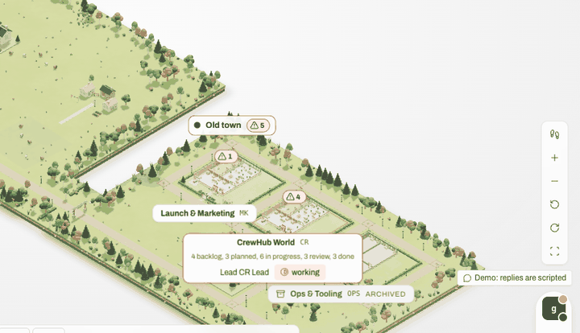 **Suggestion:** one name in all three places ("Old town" everywhere, or "No zone" on the map too).

  Prepared: `sugg/w6-5`.

- **w6-6 · polish.** "Add a zone" and "Remove this zone" say nothing: Zone 1 appears in the selects and the Undo button
  comes on, no line in the sheet and nothing in the live region, while every layout move says what it did. **Suggestion:** "Zone 1 added. Undo takes it away." and "Zone 1 removed.", as the moves say.

  Prepared: `sugg/w6-6`.

- **w6-7 · confusing.** Escape with build mode and the text view both open closes build mode behind the text view, not
  the text view on top (Settings over build mode does it the other way round). **Suggestion:** Escape closes the layer that holds the focus, as w2-1 asks for the tour.

  Prepared: `sugg/w6-7`.

- **w6-10 · confusing.** Two revision numbers for one town: the Connection panel says "Revision 1" while Settings says
  "Layout revision 0"; after edits the page says 5, the text view "Town layout revision 4", and the export is named
  after the document's number; after two tabs of undos and redos three numbers at once (10, 4 and 3). Both are called
  the revision. **Suggestion:** one number on screen (the host's record), the document's kept out of sight or named
  differently ("layout 4 of record 5").

  Prepared: `sugg/w6-10`.

- **w6-12 · polish.** Another browser's undo changes the town without a word: the zone or prop disappears and the
  build sheet says nothing; only its Undo and Redo buttons change state. **Suggestion:** "Undone in another browser. Revision 7." in the sheet and the live region.

  Prepared: `sugg/w6-12`.

- **w6-13 / w6-15 · polish.** At the Region level (Studio, 20 buildings) the build sheet is a 3 500 px scroll: the
  palette, Layout, then twenty "Zone of <building>" selects with a three-line hint each, before "Add a zone"; and the
  district card and the labels on the left are drawn under the sheet and cut by it ("…ting on a person"), in the small
  town too. 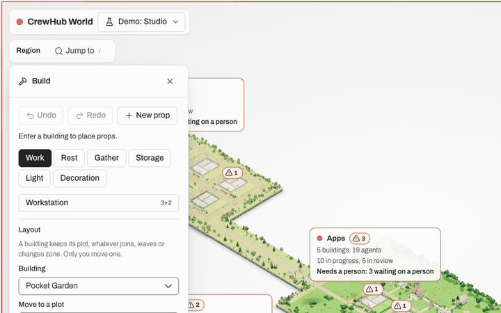 **Suggestion:** a building picker for the zone (as Layout has), and the scene framed beside the open sheet.

  Prepared: `sugg/w6-13`: the building picker, and the scene framed beside the open sheet, again after a resize. From
  601 px wide every plot stays clear of the sheet, and the town is smaller for it: zoom 0.35 at 601 wide, 0.5 at 768, and
  in the small team at 1280 x 720, 0.91 where it was 0.98. **What stays cut:** below 900 px wide Studio's Brand and Lab
  cards still reach under the sheet (up to 84 px at 601 x 700), and at every size measured there but 768 x 1024 Apps
  and Lab overlap and cover much of the town (at 640 x 800 Apps is nearly hidden). Below 800 px wide the small
  team's Launch & Marketing sign reaches under the sheet (up to 48 px). Measured in Studio and the small team only;
  inside a building, one look at 640 x 800.

- **w6-14 · polish.** "Show free plots" in the Region draws 56 badges in a tight pile over each district's centre,
  covering the district cards and each other; in the small town the sixteen read fine. 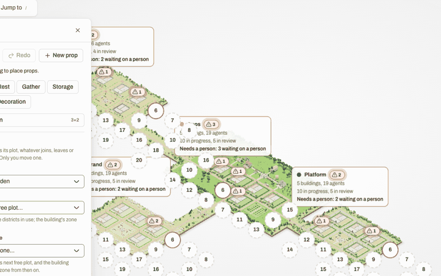 **Suggestion:** at the Region level only the next free plot per district, the rest on entering the district.

  Prepared: `sugg/w6-14`.

## What the walks added to the open design choices

One line per heading of [design-choices.md](design-choices.md); the choice itself is not restated.

- **T1. The tour card over the playback bar** (w1-1, w4-1, w5-1): on a desktop the card also cuts the archived
  building's label to "Tooling OPS ARCHIVED" and step 2's card covers a "waiting on a person" pin; on a phone there is
  no bottom-left clear of the bar, so `bottom-left` does not help there (a card above the bar, or the bar hidden while
  the tour runs, would); sideways it hides the 4x and 16x buttons.
- **T2. The focus after the tour** (w1-2, w5-2): seen by a mouse visitor (a ring on "?" nobody asked for) and by a
  keyboard one (right for them).
- **T3. The name a screen reader hears for the stage** (w1-3, w5-3; w4-3 is the same family for step 4's dock).
- **T4. The chat dock's button over the open sheets** (w1-20, w5-13): with its red badge after a scrub; it cuts
  Settings' last value to "0, alwa".
- **T5. The town's framing on a phone** (w4-4): the band of nothing under the chips, the OPS corner under the toolbar.
- **T6. The phone header's Demo chip** (w4-5): nothing says "Live" on a phone either (the "((o))" icon alone).
- **T7. The focus ring round the whole screen** (w1-10; w3 notes the full-viewport coral ring reads like an error
  state at first sight, and the text view's sheet gets the same ring).
- **T8. The host's address in the demo's Settings** (w1-7, w4-13, w5-21): met on a desktop and on a phone.
- **T9. The long Connect screen on a phone** (w4-15): 947 px at 390 wide, two swipes to the key field.
- **W1. The text view's snapshot time** (w1-4, w5-19, w2-3): also "stale since 2026-11-05T07:01:50.338Z".
- **W2. "Lit:" on a plate** (w1-5): "CR Lead is lit: CR-23 waiting on Nicky" in the text view too.
- **W3. The demo note on every plate** (w1-6): cut by the card that opened over it ("Demo: there is no crewhub-lo…").
- **W4. "Needs a person: 3 waiting on a person."** (w5-5, w5-20): the jump list's options say "Needs a person" at both
  ends ("CrewHub World Project Needs a person: 3 waiting on a person. CR. … Needs a person").
- **W7. "tonight" in Settings** (w1-8): met.
- **W15. Which bot the host's own words send people to make** (w2-8 relates: the rejected screen's reason).
- **E1. Escape in a zone's name field** (w6-8): exactly its "today"; "Harbour Escaped" survived the reload.
- **L1. "Loops down" for a host that is fine with loops** (w2-5 is the mirror case: a host restart as "Stale").
- **X1. Which agent answers are spoken** (w5: nothing is spoken when the demo's reply came; w3-1 is the sighted
  cousin).
- **X2. The sheets over the toolbar** (w3-3, w5-12; w2-2 / w3-7 relate): the Settings sheet and the Chat panel leave
  the covered camera toolbar and the chat chip in the Tab order (stops 57-60, all under the sheet); the text view does
  not, so the three sheets differ.
- **X3. The faded labels** (w1-9): "CR-18 waits on Nicky" at 0.32 beside two full-strength twins.
- **X5. The canvas's name: the whole key guide on every focus** (w5-4): read on every return to the stage, after each
  sheet and each jump.

## Findings an answer branch already covers

- **w6-11 / w4-16 · the pairing is a session cookie, so closing the browser (or a host without its secret) unpairs
  it**, while the Pair screen says "A paired browser stays paired across host restarts": `task/q1-cookie-expiry`
  (question 1's `cookie+expiry`, with question 2's 30 days) and `task/r27-tab-pairing` (question 1's `tab`) are the
  prepared answers; with either, the sentence should say when the pairing holds.
- No other finding of the six walks meets one of the seven answer branches.

## Tooling notes (not product findings)

- **The command-line fake has no chat-reading key** (`npm run loops:fake` takes `--port`, `--scenario`, `--speed`,
  `--builder-key` only), so over it a person sees the no-chat road: no bubbles over the key, Recent answers empty
  (w3, w4, w5). w3 started the in-process fake with `keyReadsChat` from a script; a `--viewer-key` flag would make
  LOOPS_SETUP section 0 show the bubbles too.
- **The fake serves no web app:** the Chat panel's frame shows its JSON 404 (`{"error":{"code":"not_found",…}}`), which
  is what a person running LOOPS_SETUP section 0 meets in the frame (w3, w4); one line there, or a small page at `/`
  on the fake, would say so.
- **The fake's clock after a sleep** (w2-3, w3): fixed this round (`task/r64-w2-fake-clock`); the fake's stamps now
  follow the wall clock through a pause.
- **`loops:fake --help`** (L-1, w1, w2-10, w4, w5): fixed and merged (`6b2b1f53`); the fake answers `--help` and
  refuses an unknown flag without starting.
- **A plain static server for `dist`** logs one console error per start (a 404 on `/world-api/health`); Vite answers
  204 and the host answers, so only a static deploy sees it (w1).
- **The fake's `startAt`** runs its clock ahead of the wall clock, so Recent answers rows show loops' times a few
  minutes in the future over such a fake (w3); against a real loops the clocks agree.

## Round 67: the prepared branches walked

If Nicky answers "all", `sugg/all-r65-on-head` (`feat/world-demo@8f783a3` plus the 40 prepared branches, `9daea890` on
5 Nov) is what a person meets. Four walkers (v1 to v4) walked round 64's six journeys on its production build, in a
headless Chromium on their own ports, each walking branches they did not build; every prepared suggestion by its own
finding's steps, and anything new checked against the base `8f783a3`. Every prepared suggestion walked was seen to work
but one, which works by half; two new findings, both confusing, none broken.

- **1. First start (v1).** w1-12, w1-14, w1-15, w1-17, w1-18 and w1-19 work as their lines say. **w1-11 works by half:**
  inside a building a click on a name pill opens that figure's card and the signs still zoom their room; in the town a
  hovered figure's pill (G-Man at the Lodge) still lets the click through, so the figure is selected and no card opens
  (a click on the body does). The base does the same, so nothing is new; the town's figures got no pick of their own.
  What became of it: finished on `sugg/w1-11` (`130f8896`, v3, reviewed by v1): the town's pills now take the click
  or tap and open the card, as the interior's do; carried into `sugg/all-r65` (`9fef220f`).
- **2. Connecting (v2).** w2-1, w2-4 and w2-7 work (Escape over the tour closes the dialog a person opened; the panel's
  variable name whole on its own line, at 320 px too; "I opened the link" says the browser is still not paired).
  w5-22's "Connected: Live." was heard at every connect, a reload at the Connect screen included. Nothing new.
- **3. Chat (v1).** w3-1, w3-2, w3-4 and w3-5 work. **New, v1-1 · confusing:** a chat mark clicked after its bubble's
  12 s ("CR Lead answered: open CrewHub World") enters the building, where nothing shows the answer: no bubble, no line,
  the chip still "Chat 1"; the answer is in the Chat panel's Recent answers and on the card, a further click away that
  nothing points to. From `sugg/w3-4` (the mark now outlives the bubble; on the base the mark went with it, so a mark
  after the bubble did not exist). One way: a mark whose bubble is gone opens the Chat panel on that agent, as a bubble
  tap does. What became of it: fixed on `sugg/w3-4` (`cb2342dc`, v4, reviewed by v1) the smaller way: the mark's
  click enters the building as before and shows the answer's bubble again over the agent for its 12 s; the mark stays
  until the chat is opened. Carried into `sugg/all-r65` (`c580dc1c`).
- **4. A phone (v3).** w4-2, w4-6, w4-8, w4-9, w4-10, w4-11, w4-12, w4-18, w4-21 and w4-22 work, upright and sideways,
  on the iPhone 13 profile (journey 1 on the Pixel 5 too); round 64's fixes w4-14 and w4-19 hold. The live chat over a
  viewer key (a bubble, the Chat count, Recent answers) was seen on the phone this time, which round 64 could not. The
  same screens on the base match in every measurement but the two the suggestions changed (the playback bar's menu
  button and slider, the shorter build sheet). Nothing new.
- **5. Keyboard and screen reader (v2).** w5-6, w5-11, w5-15, w5-16 (the tick's half), w5-17, w5-18 and w5-22 work;
  round 64's fixes w5-14, w5-24 and w5-25 hold. The Tab order is round 64's with the Chat chip right after Settings.
  Nothing new (what looked new, the fixed Escape order with two sheets open and the sheets covering the header's
  buttons, is the base's own).
- **6. The town editor (v4).** w6-2, w6-3, w6-4, w6-5, w6-6, w6-7, w6-10, w6-12, w6-13 with w6-15, and w6-14 work.
  **New, v4-1 · confusing:** "Zone 1 added. Undo takes it away." stayed under "Add a zone" after a later edit (a building
  moved to a plot, a Tidy), when Undo would do something else; two lines then promised two different undos. From
  `sugg/w6-6` (the base had no zone line). Fixed on `sugg/w6-6` by v2, reviewed by v4: the line belongs to the revision
  its edit made, so a later edit clears it, that edit's undo brings it back, a redo brings it back; carried into the
  integration branches (`sugg/w6-6@9b1bbc2e`, in `sugg/all-r65` as `61e69721`).
  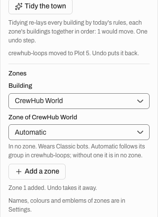

Walked and not covered: a real crewhub-loops (the fake only), a real screen reader (the live regions were read, not
spoken), the casting room on a desktop, Export and Import by keyboard, the older-host and "checking" screens. The four reports are the
round's record; this section is their sum.
